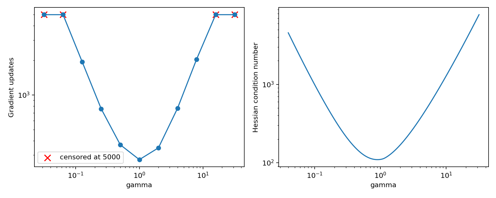

# Conditioning and gradient-method convergence

[Textbook source](https://web.stanford.edu/~boyd/cvxbook/bv_cvxbook.pdf#page=487). [Official reference 1](https://web.stanford.edu/~boyd/cvxbook/cvxbook_examples/chap9/figure_9_7.m).

## Formulation and method

```math
f(x)=c^Tx-\sum_{i=1}^{500}\log(b_i-a_i^Tx),\quad x=Tz,\quad T_{jj}=\gamma^{j/100}.
```

For each prescribed scaling, gradient descent uses the transformed gradient and backtracking. Hessian conditioning is computed at the common optimum. The extreme-scale Newton comparison uses diagonal equilibration, avoiding artificial floating-point failure from condition numbers near 1e40.

## Input provenance and comparison

Random instances use NumPy PCG64, with saved arrays and seeds. They are method reproductions; MATLAB rand(state,...) uses v5uniform and randn(state,...) uses v5normal, whereas seed selects the v4 family. Equal integer seeds do not identify equal arrays. No exact MATLAB fixture was published in the checked companion sources; exact book-figure matching is not claimed. [MATLAB generator documentation](https://www.mathworks.com/help/matlab/math/updating-your-random-number-generator-syntax.html).

The source uses a uniform (0,1) right-hand side. This reproducible replacement uses uniform (0.01,1) to avoid accidental near-zero initialization slacks. Unconverged gradient runs are explicitly censored at the published 5000-update cap.

## Recomputed output

The following values come from the checked-in [results](../../artifacts/examples/fig_9_7/results.json).

| Quantity | Computed value |
| :--- | ---: |
| gamma 0.031623: iterations | 5000 |
| gamma 0.063096: iterations | 5000 |
| gamma 0.12589: iterations | 1948 |
| gamma 0.25119: iterations | 758 |
| gamma 0.50119: iterations | 369 |
| gamma 1: iterations | 274 |
| gamma 1.9953: iterations | 347 |
| gamma 3.9811: iterations | 766 |
| gamma 7.9433: iterations | 2047 |
| gamma 15.849: iterations | 5000 |
| gamma 31.623: iterations | 5000 |
| Reference gradient norm | 8.56e-11 |



## Reproduction

```sh
OPENBLAS_NUM_THREADS=1 python -m examples.algorithms_ch09 fig_9_7
```

The implementation preserves complete numerical histories, uses explicit algorithm steps, and checks the final conditions independently. Iteration counts denote accepted updates; the initial point is iteration zero.

## Compact input delivery

Generated inputs larger than 256 KiB are represented by [array hashes and regeneration metadata](../../artifacts/examples/fig_9_7/input_manifest.json). The [regeneration helper](../../examples/algorithm_evidence.py) reconstructs every omitted array and verifies its exact bytes under the pinned numerical environment. Run the original study command to materialize all inputs locally. No problem dimension, trial count or numerical accuracy is reduced.
