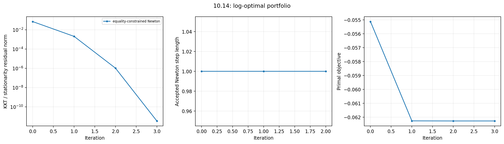

# 10.14 — Log-optimal investment with a budget equality

## Problem and scope

This is an original computational solution to the numerical exercise on printed
pages 559–560 of [Boyd and Vandenberghe, *Convex Optimization*](https://web.stanford.edu/~boyd/cvxbook/bv_cvxbook.pdf#page=573).
The portfolio interpretation is defined in exercise 4.60. Here the nonnegative
allocation restriction is removed, but the budget equation remains. In particular,
short positions are allowed; positive return in every scenario is still required
by the logarithm's domain. There are no omitted subparts.

Put each scenario return vector in a **row** of the matrix

```math
P=\begin{bmatrix}2&1.3&1\\2&0.5&1\\0.5&1.3&1\\0.5&0.5&1\end{bmatrix},
\qquad \pi=(1/3,1/6,1/3,1/6).
```

We minimize $`f(x)=-\sum_j\pi_j\log(Px)_j`$, subject to
$`\mathbf1^Tx=1`$, on $`Px>0`$. We do **not** add $`x\ge0`$.

## Derivatives and Newton step

Writing $`q=Px`$,

```math
g=-P^T(\pi/q),\qquad
H=P^T\mathrm{diag}(\pi/q^2)P.
```

Elementwise division is intended. The Hessian is positive definite because
$`P`$ has full column rank and all scenario probabilities are positive. Solve

```math
\begin{bmatrix}H&\mathbf1\\\mathbf1^T&0\end{bmatrix}
\begin{bmatrix}\Delta x\\\nu\end{bmatrix}
=\begin{bmatrix}-g\\0\end{bmatrix}.
```

Starting from $`x^{(0)}=(1,1,1)/3`$, backtracking with $`\alpha=0.01`$,
$`\beta=0.5`$ first checks $`P(x+t\Delta x)>0`$, then the objective
Armijo inequality. Every accepted step preserves the budget. We stop when the
combined stationarity and equality residual is at most $`10^{-11}`$.

The implementation permits an 8-machine-epsilon objective-comparison allowance
at the final steps, to avoid backtracking on changes below floating-point
summation accuracy. The reported KKT residual remains the convergence criterion.

## Numerical answer

The unrestricted optimum is

```math
x^\star\simeq(0.497251048538,\ 0.199368022138,\ 0.303380929324),
```

with expected logarithmic growth $`0.0622715794965`$ per period. The four
scenario returns are approximately
$`(1.55706145518,1.39756703747,0.811184882373,0.651690464662)`$.
All happen to be supported by positive allocations, although positivity was
never imposed. Three Newton steps suffice from the specified starting point;
the final KKT residual is $`3.39\times10^{-12}`$.

With the minimization Lagrangian convention
$`L=f+\nu(\mathbf1^Tx-1)`$, the optimum multiplier is $`\nu^\star=1`$.
Indeed, $`x^Tg=-\sum_j\pi_j=-1`$, so stationarity and the budget imply
$`-1+\nu=0`$. This also supplies an exact independent check of the multiplier.

A separately modeled CVXPY/CLARABEL problem agrees in objective within
$`1.6\times10^{-11}`$ and in allocation norm within $`4.9\times10^{-6}`$.
An exponential-cone solver's objective tolerance does not imply that its point
matches the high-accuracy Newton point to the same number of digits.

## Reproduce and inspect

```sh
convex-solutions run 10.14 --seed 0 --output artifacts/10.14
pytest tests/test_chapter10.py -q
```

- Implementation: `src/convex_solutions/chapters/ch10/ex_10_14.py`, with Newton code in `ch10/common.py`
- Numerical history: `artifacts/10.14/exercise_10_14.json`
- Plot: `artifacts/10.14/10_14_newton.png`



The tests also start from a feasible portfolio containing a negative allocation,
verify objective descent, and recover the same optimum. The seed is recorded for
interface consistency; this exercise's problem data are fixed.
