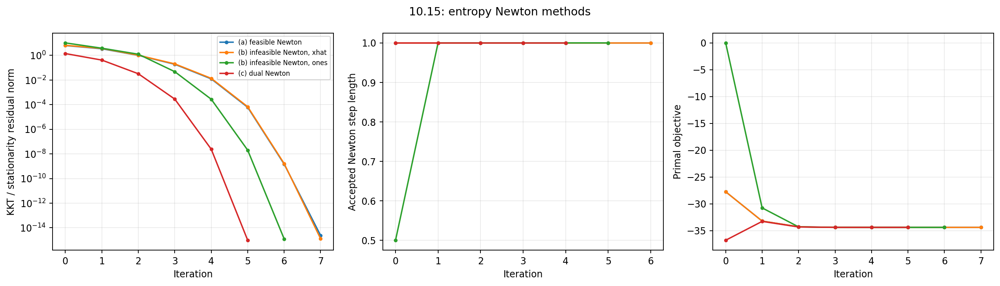

# 10.15 — Equality-constrained entropy: three Newton formulations

## Problem, generation, and coverage

This original solution addresses all parts of the exercise on printed page 560
of [Boyd and Vandenberghe, *Convex Optimization*](https://web.stanford.edu/~boyd/cvxbook/bv_cvxbook.pdf#page=574):

- (a) feasible-start Newton, initialized at the constructed feasible point;
- (b) infeasible-start Newton, initialized both at that point and at the all-ones vector;
- (c) Newton applied to the dual;
- comparison of all recovered primal points and equality multipliers, and structure-aware work per step.

The primal problem is

```math
\min_{x>0}\ \sum_{i=1}^n x_i\log x_i,\qquad Ax=b.
```

The supplied experiment uses the requested $`n=100,p=30`$.
A local NumPy generator makes $`A_{ij}\sim\mathcal N(0,1/n)`$, checks
$`\mathrm{rank}(A)=p`$, draws $`\hat x_i\sim U[0.05,1]`$, and sets
$`b=A\hat x`$. This is a strictly positive feasible instance. The lower endpoint
0.05 avoids unusually small starting coordinates; the exercise allows any random
positive feasible vector. Nothing is normalized to sum to one, because no such
constraint appears in this entropy problem.

All methods use $`\alpha=0.01,\beta=0.5`$ and stop when the full primal-dual
KKT residual norm is at most $`10^{-10}`$. All multiplier conventions use
$`L(x,\nu)=\sum_i x_i\log x_i+\nu^T(Ax-b)`$.

## (a) Feasible-start Newton

Let $`X=\mathrm{diag}(x)`$. Then

```math
g=\log x+\mathbf1,\qquad H=X^{-1}.
```

The feasible direction and current multiplier estimate solve

```math
H\Delta x+A^T\nu=-g,\qquad A\Delta x=0.
```

Eliminating the diagonal Hessian gives

```math
(AXA^T)\nu=-AXg,\qquad \Delta x=-X(g+A^T\nu).
```

We use objective Armijo backtracking and preserve positivity before testing the
objective. The initial point is $`\hat x`$, and the equality remains satisfied
up to roundoff. Near convergence, objective comparisons allow an explicit
machine-precision slack; stationarity, rather than an unresolvable objective
change, determines termination.

## (b) Infeasible-start Newton

Define

```math
r_d=\log x+\mathbf1+A^T\nu,\qquad r_p=Ax-b.
```

The Newton equations are

```math
\begin{bmatrix}X^{-1}&A^T\\ A&0\end{bmatrix}
\begin{bmatrix}\Delta x\\\Delta\nu\end{bmatrix}
=-\begin{bmatrix}r_d\\r_p\end{bmatrix}.
```

The implemented elimination is

```math
(AXA^T)\Delta\nu=r_p-AXr_d,\qquad
\Delta x=-X(r_d+A^T\Delta\nu).
```

Backtracking requires a positive trial point and
$`\|r(x+t\Delta x,\nu+t\Delta\nu)\|_2 \le(1-\alpha t)\|r(x,\nu)\|_2`$.
Both requested runs use $`\nu^{(0)}=0`$, with $`x^{(0)}=\hat x`$ or
$`x^{(0)}=\mathbf1`$. A full step makes the linear primal residual zero;
subsequent steps retain primal feasibility.

## (c) Dual Newton

Minimizing the Lagrangian over each positive coordinate gives

```math
x_i(\nu)=\exp(-1-(A^T\nu)_i),\qquad
q(\nu)=-\sum_i\exp(-1-(A^T\nu)_i)-b^T\nu.
```

Thus maximizing the dual is equivalent to unconstrained minimization of

```math
\phi(\nu)=\sum_i\exp(-1-(A^T\nu)_i)+b^T\nu,
\quad \nabla\phi=b-Ax(\nu),\quad
\nabla^2\phi=A\mathrm{diag}(x(\nu))A^T.
```

We start at $`\nu^{(0)}=0`$, take Newton directions with objective Armijo
backtracking, and recover $`x`$ from the exponential formula. The primal
stationarity residual is then zero by construction; the dual gradient is the
negative primal feasibility residual. Trial overflow or underflow is rejected.

Strict positivity of the weights and full row rank of $`A`$ make every
$`AXA^T`$ positive definite. The primal objective is strictly convex; its
strictly feasible entropy optimum is positive, and the full-row-rank equality
system gives a unique multiplier. These facts explain why the formulations
recover the same pair, rather than merely the same objective value.

## Numerical comparison, seed 0

| Method | Steps | Backtracking reductions | Final KKT residual |
|---|---:|---:|---:|
| Feasible Newton from $`\hat x`$ | 7 | 0 | $`2.37\times10^{-15}`$ |
| Infeasible Newton from $`\hat x`$ | 7 | 0 | $`1.28\times10^{-15}`$ |
| Infeasible Newton from ones | 6 | 1 | $`1.25\times10^{-15}`$ |
| Dual Newton from zero | 5 | 0 | $`9.69\times10^{-16}`$ |

All objective values are $`-34.39049476779433`$. The largest point difference
from dual Newton is $`2.53\times10^{-15}`$, and the largest multiplier
difference is $`8.95\times10^{-15}`$. The output JSON contains all 100 primal
coordinates and all 30 multiplier coordinates for each method.

The independently modeled CVXPY/CLARABEL result agrees within
$`9.2\times10^{-11}`$ in objective, $`8.7\times10^{-6}`$ in primal norm,
and $`2.1\times10^{-5}`$ in multiplier norm. These solver-level point errors
are reported separately from the much tighter agreement between the four
explicit Newton runs. Feasible and infeasible methods can take different paths
because they use different merit functions; equal iteration counts here are
an empirical result for this seed, not an identity between algorithms.

## Structure-aware cost per step

For **all three formulations**, the dominating operations are the same:

1. form the weighted Gram matrix $`M=AXA^T`$: $`O(np^2)`$ work;
2. factor the $`p\times p`$ positive-definite matrix: $`O(p^3)`$ work;
3. solve for a multiplier direction or estimate, and recover the primal
   direction if needed: $`O(p^2+np)`$ work.

Therefore each Newton direction costs $`O(np^2+p^3)`$, with
$`O(np+p^2)`$ storage including the dense data matrix. Forming only one
triangle uses about $`np^2`$ leading flops, and Cholesky costs about
$`p^3/3`$; ordinary dense matrix multiplication may compute both triangles.
Each line-search evaluation costs $`O(n)`$ for the feasible primal objective
and $`O(np)`$ for the infeasible residual or dual objective. The dual stores
only $`p`$ optimization variables but still evaluates $`n`$ exponentials and
forms the same Gram matrix, so it does not change the leading direction cost.
Solving an unstructured $`(n+p)`$-dimensional KKT system instead would cost
$`O((n+p)^3)`$. The supplied code actually uses the structured elimination.

## Reproduce and inspect

```sh
convex-solutions run 10.15 --seed 0 --output artifacts/10.15
pytest tests/test_chapter10.py -q
```

- Driver: `src/convex_solutions/chapters/ch10/ex_10_15.py`
- Algorithms and generation: `src/convex_solutions/chapters/ch10/common.py`
- Exact generated matrices and feasible starting point: `artifacts/10.15/10_15_data.npz`
- All points, multipliers, histories, and comparisons: `artifacts/10.15/exercise_10_15.json`
- Required-method comparison plot: `artifacts/10.15/10_15_methods.png`



The plotted objective for dual Newton is the recovered **primal** objective,
which need not decrease before primal feasibility is attained. Its line search
uses the dual minimization objective $`\phi`$, as derived above. Tests check
three further random instances, differentiate the dual numerically, and compare
the eliminated direction with an independently assembled full KKT solve.
