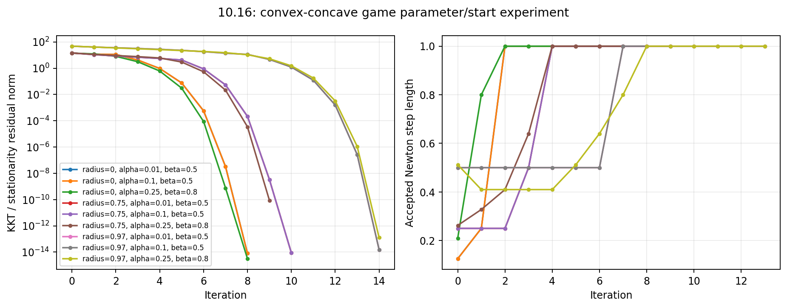

# 10.16 — Newton's method for a convex-concave game

## Problem and experiment coverage

This is an original solution to the numerical exercise on printed page 560
of [Boyd and Vandenberghe, *Convex Optimization*](https://web.stanford.edu/~boyd/cvxbook/bv_cvxbook.pdf#page=574),
using the payoff in equation (10.32), printed page 542. It includes random
problem generation, explicit Newton steps, residual and step-length plots, and
a crossed experiment over three backtracking choices and three starting-point
radii. No requested component is omitted.

The minimizing player chooses $`u`$, the maximizing player chooses $`v`$, and

```math
f(u,v)=u^TAv+b^Tu+c^Tv-\log(1-u^Tu)+\log(1-v^Tv),
\qquad \|u\|_2<1,\ \|v\|_2<1.
```

We use $`p=q=100`$, matching the dimensions of the book's example. A seeded
local generator draws independent $`A_{ij}\sim\mathcal N(0,1/q)`$,
$`b_i,c_j\sim\mathcal N(0,1)`$. These distributions specify a reproducible
instance; the book does not prescribe a unique random draw.

## Residual and Jacobian

With $`s_u=1-u^Tu`$, $`s_v=1-v^Tv`$, stationarity is

```math
r(u,v)=\begin{bmatrix}Av+b+2u/s_u\\ A^Tu+c-2v/s_v\end{bmatrix}=0.
```

Define

```math
H_u=2I/s_u+4uu^T/s_u^2,\qquad
H_v=2I/s_v+4vv^T/s_v^2.
```

Then the residual Jacobian is the symmetric indefinite matrix

```math
J=\begin{bmatrix}H_u&A\\ A^T&-H_v\end{bmatrix}.
```

The code solves $`J\Delta z=-r`$ directly using a symmetric linear solve.
An SPD elimination is also possible: solve with $`H_u`$, then with the
Schur complement $`H_v+A^TH_u^{-1}A`$. Unlike a convex minimization Hessian,
$`J`$ itself must **not** be treated as positive definite.

Both $`H_u\succeq2I`$ and $`H_v\succeq2I`$, so the game is strongly
convex-concave. Its saddle point is unique. Negating the second residual block
would give a strongly monotone operator; the Newton direction and residual norm
are unchanged by that consistent sign convention.

## Residual line search and starts

Starting from $`t=1`$, we multiply by $`\beta`$ until both trial strategies
are strictly inside their unit balls and

```math
\|r(z+t\Delta z)\|_2\le(1-\alpha t)\|r(z)\|_2.
```

We use a residual merit function; the saddle payoff itself is not expected to
monotonically increase or decrease. Termination requires residual at most
$`10^{-10}`$, and hitting the iteration limit or failing the line search
raises an error instead of returning a false convergence result.

Two random unit directions are generated with a separate local seed. Their
radii are 0, 0.75, and 0.97, crossed with
$`(\alpha,\beta)=(0.01,0.5),(0.1,0.5),(0.25,0.8)`$.
Thus all nine starts satisfy the domain requirement, including the near-boundary
case. Within each radius group, only the line-search parameters change.

## Results for seed 0

Each cell below gives accepted Newton steps / total backtracking reductions.

| Initial radius | $`(0.01,0.5)`$ | $`(0.1,0.5)`$ | $`(0.25,0.8)`$ |
|---|---:|---:|---:|
| 0 | 8 / 5 | 8 / 5 | 8 / 8 |
| 0.75 | 10 / 7 | 10 / 7 | 9 / 17 |
| 0.97 | 14 / 7 | 14 / 7 | 14 / 25 |

All runs converge to the same saddle point, with
$`\|u^\star\|_2\simeq0.899469309148`$,
$`\|v^\star\|_2\simeq0.907397380797`$, and payoff
$`f(u^\star,v^\star)\simeq0.741623615816`$.
The largest final residual is $`8.77\times10^{-11}`$; most runs reach
approximately $`10^{-14}`$.

For this instance, changing $`\alpha`$ from 0.01 to 0.1 leaves accepted step
lengths unchanged. A larger $`\beta`$ searches the step-length grid more
finely and requires more rejected trials; it saves one Newton step from radius
0.75 but not from the other starts. The near-boundary start needs additional
damped progress before entering the fast local-convergence phase. These are
measured conclusions, not universal performance rankings of the parameters.

## Independent saddle-point checks

There is a useful closed-form best response that does not use the implemented
Hessian. For fixed $`v`$, set $`a=Av+b`$; for fixed $`u`$, set
$`d=A^Tu+c`$. Then

```math
u_{\rm br}=-\frac{a}{1+\sqrt{1+\|a\|^2}},\qquad
v_{\rm br}=\frac{d}{1+\sqrt{1+\|d\|^2}}.
```

These follow by solving each player's radial stationarity equation and always
lie inside the unit ball. We independently solve the best-response fixed-point
equations with SciPy's finite-difference `root` method. Its point differs from
the Newton results by at most $`1.31\times10^{-12}`$.

At each computed point, the code also evaluates the nonnegative saddle gap

```math
f(u,v_{\rm br})-f(u_{\rm br},v).
```

It is zero up to floating-point cancellation. Tests separately verify the
payoff gradient and full indefinite Hessian by finite differences, line-search
contraction at every accepted step, and the global saddle inequalities under
independent random unilateral deviations.

## Reproduce and inspect

```sh
convex-solutions run 10.16 --seed 0 --output artifacts/10.16
pytest tests/test_chapter10.py -q
```

- Driver: `src/convex_solutions/chapters/ch10/ex_10_16.py`
- Newton method and derivative routines: `src/convex_solutions/chapters/ch10/common.py`
- Matrices, vectors, and initial directions: `artifacts/10.16/10_16_data.npz`
- All nine histories, saddle points, gaps, and comparisons: `artifacts/10.16/exercise_10_16.json`
- Requested residual and accepted-step plots: `artifacts/10.16/10_16_game.png`



Residual histories include the initial point and the terminal point. Step-length
entry $`k`$ is the accepted step from iterate $`k`$ to $`k+1`$.
