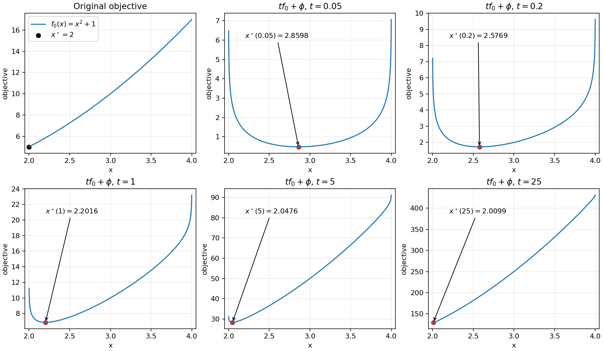

# Exercise 11.1 — A barrier central path

**Source:** Boyd and Vandenberghe, *Convex Optimization*, exercise 11.1, printed p. 623 ([official book](https://web.stanford.edu/~boyd/cvxbook/bv_cvxbook.pdf)). This is an original derivation and implementation.

## Solution

For the two inequalities $`2-x\le0`$ and $`x-4\le0`$, the logarithmic barrier is

```math
\phi(x)=-\log(x-2)-\log(4-x),\qquad 2\lt x\lt 4.
```

At a fixed positive $`t`$, the centering objective is

```math
F_t(x)=t(x^2+1)-\log(x-2)-\log(4-x).
```

Its derivatives are

```math
F_t'(x)=2tx-\frac1{x-2}+\frac1{4-x},\qquad
F_t''(x)=2t+\frac1{(x-2)^2}+\frac1{(4-x)^2}>0.
```

Consequently there is exactly one central point. It is the root of

```math
tx(x-2)(4-x)+x-3=0
```

in $`(2,4)`$. We find that root with a bracketed scalar solver, rather than choosing among the three roots of a cubic. Because the derivative at $`x=3`$ is $`6t>0`$, the root belongs to $`(2,3)`$. It decreases toward the constrained optimum $`x^\star=2`$ as $`t\to\infty`$, and tends to the interval's analytic center, 3, as $`t\downarrow0`$.

The multipliers recovered from a central point are

```math
\lambda_1=\frac1{t(x-2)},\qquad \lambda_2=\frac1{t(4-x)}.
```

They satisfy stationarity $`2x-\lambda_1+\lambda_2=0`$, and their complementarity sum is $`2/t`$. Thus $`f_0(x^\star(t))-5\le2/t`$.

<!-- BEGIN GENERATED RESULTS -->
## Executed results

The full-size experiment was executed at **2026-10-10T03:19:28.536425Z**, with seed **0** and Python **3.12.14**. The tables below are generated directly from this run's [recorded output](../../artifacts/11.1/results.json), rather than illustrative or expected values. See the [execution record](../../coverage/results-refresh.json) for the exact command, package versions, source fingerprint, and checks.

The independent analytical constrained optimum is x = 2, objective = 5. The bracketed scalar solves produced:

| t | Central point | Original objective | Objective error | Bound 2/t | Centering derivative residual |
| --- | --- | --- | --- | --- | --- |
| 0.05 | 2.859818930297 | 9.178564314084 | 4.1785643141 | 40 | 3.331e-16 |
| 0.2 | 2.576887523916 | 7.640349310916 | 2.6403493109 | 10 | 1.110e-16 |
| 1 | 2.201639675723 | 5.847217261719 | 0.84721726172 | 2 | 5.218e-15 |
| 5 | 2.047644798803 | 5.192849222065 | 0.19284922207 | 0.4 | 8.904e-14 |
| 25 | 2.009901230362 | 5.039702955809 | 0.039702955809 | 0.08 | 2.219e-12 |

The following multipliers are evaluated from the stored central points using the formulas above. Their complementarity sum is 2/t; their Lagrangian stationarity residual is the centering derivative residual divided by t.

| t | Lower-bound multiplier | Upper-bound multiplier | Complementarity sum |
| --- | --- | --- | --- |
| 0.05 | 23.260711407 | 17.541073547 | 40 |
| 0.2 | 8.6672007847 | 3.5134257369 | 10 |
| 1 | 4.9593414412 | 0.55606208973 | 2 |
| 5 | 4.1977299731 | 0.10244037554 | 0.4 |
| 25 | 4.0399019656 | 0.020099504914 | 0.08 |

All five roots are strictly interior, decrease toward 2, and satisfy the displayed objective-gap bound. The seed is recorded for CLI consistency; this experiment has no random data.


<!-- END GENERATED RESULTS -->

## Reproduce and inspect

Run `convex-solutions run 11.1 --output artifacts/11.1 --seed 0` from the repository root. Direct Python use is `ex_11_1.solve(Path("artifacts/11.1"))`.

`barrier_central_path.png` includes the original objective and five separate centering plots, for $`t=0.05,0.2,1,5,25`$. Each panel labels its own $`x^\star(t)`$; separate vertical scales avoid hiding the small-$`t`$ curves. `results.json` records the central points, stationarity residuals, objective gaps, and theoretical bounds.

Tests check strict interiority, monotonic approach to 2, the derivative equation, and the gap inequality. A nonpositive $`t`$ is rejected.
