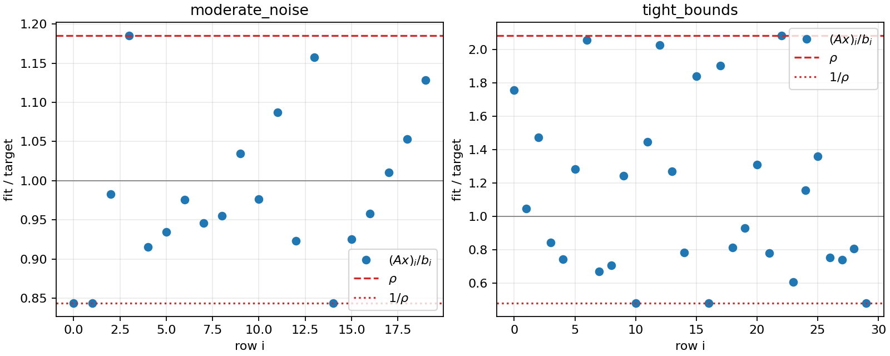

# Exercise 11.21 — Bounded fractional Chebyshev approximation

**Source:** Boyd and Vandenberghe, *Convex Optimization*, exercise 11.21(a–b), printed p. 629 ([official book](https://web.stanford.edu/~boyd/cvxbook/bv_cvxbook.pdf)). The data below are reproducible synthetic experiments, not omitted textbook data.

## (a) Smooth convex formulation

Write $`y=Ax`$ and introduce an epigraph variable $`\rho`$. The desired problem is

```math
\begin{array}{ll}
\text{minimize}&\rho\\
\text{subject to}&y_i/b_i-\rho\le0,\quad b_i/y_i-\rho\le0,\quad i=1,\ldots,m,\\
&l_j-x_j\le0,\quad x_j-u_j\le0,\quad j=1,\ldots,n,
\end{array}
```

with domain $`Ax\succ0`$. The first and last two families are affine. The map $`y_i\mapsto b_i/y_i`$ is convex and twice differentiable on $`y_i>0`$, because $`b_i>0`$. All the requested functions are therefore convex and twice differentiable on their domain. The variable $`\rho`$ automatically satisfies $`\rho\ge1`$ at every feasible point. There is no need to add this inequality to the barrier.

Minimizing $`\rho`$ also minimizes $`\log\rho=\max_i|\log y_i-\log b_i|`$. Directly placing absolute values around logarithms would not give the smooth convex formulation above. The row index runs to $`m`$, the number of observations; the book's displayed maximum using $`n`$ is understood as a row-index typo.

## (b) Implemented barrier method

Collect the $`M=2m+2n`$ scalar inequalities in $`g(z)\le0`$, with $`z=(x,\rho)`$, and minimize

```math
F_t(z)=t\rho-\sum_{k=1}^M\log(-g_k(z)).
```

If $`J`$ is the Jacobian whose rows are $`\nabla g_k^T`$, $`s=-g(z)`$, and $`w_k=1/s_k`$, then

```math
\nabla F_t=t e_{n+1}+J^Tw,\qquad
\nabla^2F_t=J^T\mathrm{diag}(w^2)J+
\sum_k w_k\nabla^2g_k.
```

Only the reciprocal constraints have a nonzero constraint Hessian. For $`g_{m+i}=b_i/y_i-\rho`$,

```math
\nabla_xg_{m+i}=-\frac{b_i}{y_i^2}a_i,\quad
\partial_\rho g_{m+i}=-1,\quad
\nabla_{xx}^2g_{m+i}=\frac{2b_i}{y_i^3}a_i a_i^T.
```

Given the allowed $`x^{(0)}`$, initialize

```math
\rho^{(0)}=1+\max_i\{(Ax^{(0)})_i/b_i,\ b_i/(Ax^{(0)})_i\}.
```

This makes all barrier slacks strictly positive. Each centering stage uses a dense Newton solve, a domain check, and Armijo backtracking. After centering, multiply $`t`$ by 12 until the nominal central-path bound $`M/t\le10^{-6}`$. The code records every accepted Newton step and the stages' decrement values; an iteration or line-search failure raises an error.

### A finite-centering certificate

The exact central-path theorem gives $`M/t`$ only at an exact center. The implementation additionally accounts for the measured stationarity residual.

Let $`\lambda_k=1/(ts_k)`$, $`r=\nabla_z L(z,\lambda)`$, and $`f(z)=\rho`$. Convexity gives

```math
L(z',\lambda)\ge L(z,\lambda)+r^T(z'-z).
```

An optimum lies in the box $`B=[l,u]\times[1,\rho]`$, since the current point is feasible. Therefore

```math
p^\star\ge \rho-M/t+
\sum_{j=1}^n\min\{r_j(l_j-x_j),r_j(u_j-x_j)\}
+\min\{r_{n+1}(1-\rho),0\}.
```

This is the reported `certified_lower_bound`. The difference from the current objective is `certified_objective_gap`. It is distinct from the nominal `central_path_gap_bound`. This certificate requires no optimization package or approximate dual-feasibility assertion.

## Experiments and verification

Two bounded problems are generated with a local seeded NumPy generator: a 20-by-6 moderate-noise problem and a 30-by-8 tighter, noisier fit. All generated data and the strict initial points are saved. CVXPY/CLARABEL solves the reciprocal epigraph model independently, with tighter solver tolerances.

<!-- BEGIN GENERATED RESULTS -->
## Executed results

The full-size experiment was executed at **2026-10-10T03:19:28.774894Z**, with seed **0** and Python **3.12.14**. The tables below are generated directly from this run's [recorded output](../../artifacts/11.21/results.json), rather than illustrative or expected values. See the [execution record](../../coverage/results-refresh.json) for the exact command, package versions, source fingerprint, and checks.

### (a–b) Executed epigraph formulation and barrier solutions

| Instance | m × n | Newton steps | Barrier ρ | Reference ρ | Objective difference | Reference / status |
| --- | --- | --- | --- | --- | --- | --- |
| moderate_noise | 20 × 6 | 55 | 1.185329917838 | 1.185329783232 | 1.346e-07 | CLARABEL / optimal |
| tight_bounds | 30 × 8 | 58 | 2.081503116011 | 2.081502997723 | 1.183e-07 | CLARABEL / optimal |

### Feasibility and finite-centering certificates

| Instance | Certified lower bound | Certified objective gap | Nominal M/t | Stationarity residual | Primal violation |
| --- | --- | --- | --- | --- | --- |
| moderate_noise | 1.185328915951 | 1.002e-06 | 1.000e-06 | 2.951e-06 | 0 |
| tight_bounds | 2.081502115419 | 1.001e-06 | 1.000e-06 | 1.010e-09 | 0 |

The certified gaps include the finite-centering correction. They are the reported upper bounds on objective error; the differences from CLARABEL alone would not be certificates.

| Instance | Actual worst ratio / reciprocal | Log-Chebyshev error | Minimum fitted ratio | Maximum fitted ratio |
| --- | --- | --- | --- | --- |
| moderate_noise | 1.1853298757 | 0.17002111201 | 0.84364700597 | 1.1853298757 |
| tight_bounds | 2.0815030812 | 0.73309026792 | 0.48042206089 | 2.0815030685 |

Final x for **moderate_noise**: (1.06894826, 0.157575026, 0.766247568, 0.349976681, 0.725504561, 0.427491558).

Final x for **tight_bounds**: (0.71528106, 1.04760443, 0.185348475, 1.03630321, 1.04873971, 0.54379038, 1.11903493, 0.448973965).

The fitted ratios were recomputed from the saved A, b, and x. The slightly larger epigraph value ρ keeps every barrier inequality strict. All input arrays, bounds, multipliers, and histories are in the linked JSON.


<!-- END GENERATED RESULTS -->

## Reproduce and inspect

Run `convex-solutions run 11.21 --output artifacts/11.21 --seed 0`. Outputs are `results.json` and `fractional_fit.png`, which shows the fitted ratios inside $`[1/\rho,\rho]`$. Tests compare two seeds, finite-difference both derivatives, verify primal feasibility and the conservative certificate, and reject an invalid strict starting point.
