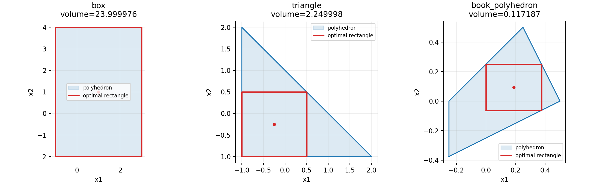

# Exercise 11.22 — Maximum-volume rectangle inside a polyhedron

**Source:** Boyd and Vandenberghe, *Convex Optimization*, exercise 11.22, printed p. 629, with the rectangle formulation of exercise 8.16 ([official book](https://web.stanford.edu/~boyd/cvxbook/bv_cvxbook.pdf)). The specified matrix is used exactly.

## Convex formulation

Use a center $`c=(l+u)/2`$ and a positive half-width vector $`r=(u-l)/2`$. The largest value of $`a_i^Tx`$ over the rectangle is $`a_i^Tc+|a_i|^Tr`$. Containment is therefore exactly

```math
Ac+|A|r\preceq b.
```

The volume is $`2^n\prod_jr_j`$. Maximize its logarithm, or equivalently solve

```math
\min_{c,\ r\succ0}-\sum_j\log r_j
\quad\text{subject to}\quad Ac+|A|r\preceq b.
```

The positive-radius requirement is the objective's domain. It does not add a separate log-barrier term. With $`G=[A\ |A|]`$, $`z=(c,r)`$, and $`s=b-Gz`$, the centering objective and derivatives are

```math
F_t(z)=-t\sum_j\log r_j-\sum_i\log s_i,
```

```math
\nabla F_t=G^Ts^{-1}-t\begin{bmatrix}0\\r^{-1}\end{bmatrix},\qquad
\nabla^2F_t=G^T\mathrm{diag}(s^{-2})G+
\begin{bmatrix}0&0\\0&t\mathrm{diag}(r^{-2})\end{bmatrix}.
```

Vector inverses and squares are componentwise. The nominal gap after exact centering is $`m/t`$, rather than $`(m+n)/t`$.

Since $`b\succ0`$, start at $`c=0`$, $`r=\delta\mathbf1`$, where

```math
\delta=\frac14\min_{i:\|a_i\|_1>0}\frac{b_i}{\|a_i\|_1}.
```

The routine applies Newton centering and strictly feasible Armijo backtracking. It returns lower and upper corners, volume, multipliers, residuals, and iteration history.

## A checkable dual certificate

For the negative-log-radius minimization, a nonnegative multiplier $`\lambda`$ is dual feasible if $`A^T\lambda=0`$ and $`d=|A|^T\lambda\succ0`$. Its dual objective is

```math
g(\lambda)=\sum_j(1+\log d_j)-b^T\lambda.
```

This follows by minimizing $`d_jr_j-\log r_j`$ at $`r_j=1/d_j`$; minimizing over $`c`$ requires $`A^T\lambda=0`$.

Raw central-path multipliers can have a small stationarity error. For a valid numerical certificate, the implementation drops tiny inactive multipliers, projects the active multipliers onto $`A^T\lambda=0`$, and explicitly checks positivity and the equality residual. When that check succeeds it reports the measured primal-minus-dual gap. If the projection fails on another input, it returns no certificate instead of labeling the nominal central-path value as one. All three delivered instances have a verified certificate.

## The specified polyhedron: an exact answer

For the five rows given in the exercise, the optimal corners are

```math
\boxed{l=(0,-1/16),\qquad u=(3/8,1/4)},\qquad
\boxed{\mathrm{vol}(R)=15/128=0.1171875}.
```

The corresponding center is $`c=(3/16,3/32)`$ and half-widths are $`r=(3/16,5/32)`$. Rows 2, 3, and 4 are active. A dual certificate is

```math
\lambda=(0,4/5,8/15,2/3,0).
```

Indeed, $`A^T\lambda=0`$, $`|A|^T\lambda=(16/3,32/5)=r^{-1}`$, and complementary slackness holds. These are the sufficient convex KKT conditions. This verifies the numerical answer analytically. The first inequality is redundant for this polygon; five supplied inequalities produce four polygon vertices.

## Other tests and reproduction

The implementation also solves an axis-aligned box with corners $`(-1,-2)`$, $`(3,4)`$, whose maximum rectangle volume is 24, and the triangle $`x_1+x_2\le1`$, $`x_1,x_2\ge-1`$, whose optimum has corners $`(-1,-1)`$, $`(1/2,1/2)`$ and volume 2.25. These test different active-constraint patterns. CLARABEL independently solves each log-volume model.

<!-- BEGIN GENERATED RESULTS -->
## Executed results

The full-size experiment was executed at **2026-10-10T03:19:29.061498Z**, with seed **0** and Python **3.12.14**. The tables below are generated directly from this run's [recorded output](../../artifacts/11.22/results.json), rather than illustrative or expected values. See the [execution record](../../coverage/results-refresh.json) for the exact command, package versions, source fingerprint, and checks.

### Computed rectangles, including the specified matrix

| Polyhedron | Lower corner | Upper corner | Computed volume | Exact volume | Newton steps |
| --- | --- | --- | --- | --- | --- |
| box | (-0.999999, -1.9999985) | (2.999999, 3.9999985) | 23.99997600002 | 24 | 43 |
| triangle | (-0.9999995, -0.9999995) | (0.49999975, 0.49999975) | 2.249997750002 | 2.25 | 37 |
| book_polyhedron | (-1.666527222e-09, -0.06250001208) | (0.3749998508, 0.2499999233) | 0.1171874296878 | 0.1171875 | 42 |

### Independent log-volume comparison

| Polyhedron | Barrier log-volume | Reference log-volume | Reference minus barrier | Reference / status |
| --- | --- | --- | --- | --- |
| box | 3.178052830348 | 3.178053828232 | 9.979e-07 | CLARABEL / optimal |
| triangle | 0.8109292162166 | 0.8109302159367 | 9.997e-07 | CLARABEL / optimal |
| book_polyhedron | -2.143980662815 | -2.143980063839 | 5.990e-07 | CLARABEL / optimal |

### Numerical certificates

| Polyhedron | Certified negative-log-radius gap | Containment violation | Minimum slack | Raw stationarity residual | Projected dual equality residual |
| --- | --- | --- | --- | --- | --- |
| box | 1.000e-06 | 0 | 1.000e-06 | 1.886e-08 | 0 |
| triangle | 1.000e-06 | 0 | 5.000e-07 | 8.924e-10 | 0 |
| book_polyhedron | 6.000e-07 | 0 | 2.500e-07 | 2.805e-05 | 3.140e-16 |

For the book instance, the projected dual-feasible multiplier is (0, 0.800002898339, 0.533335265559, 0.666669081949, 0) and its dual objective is 3.530274423924. The dual equality residual was recomputed from the saved A and projected multipliers. All three certificates use nonnegative multipliers and positive radius coefficients. The nominal gap is 1e-6, while the table reports the independently evaluated feasible primal-minus-dual gap. The factor 2 in each full width contributes an additive constant to log-volume, so it does not affect this gap.

The small corner offsets are expected from strict interiority at finite barrier parameter. The analytic solutions above give an additional independent check of the computed volumes.


<!-- END GENERATED RESULTS -->

## Reproduce and inspect

Run `convex-solutions run 11.22 --output artifacts/11.22 --seed 0`. The figure `maximum_volume_rectangles.png` includes the specified polygon and optimum rectangle, as well as the two simple examples. `results.json` saves all vertices indirectly through the supplied matrices, all solutions, and certificates.

Tests finite-difference the gradient/Hessian, compare the analytic solutions and independent solver, check containment and the dual equalities, and verify the polygon reconstruction.
