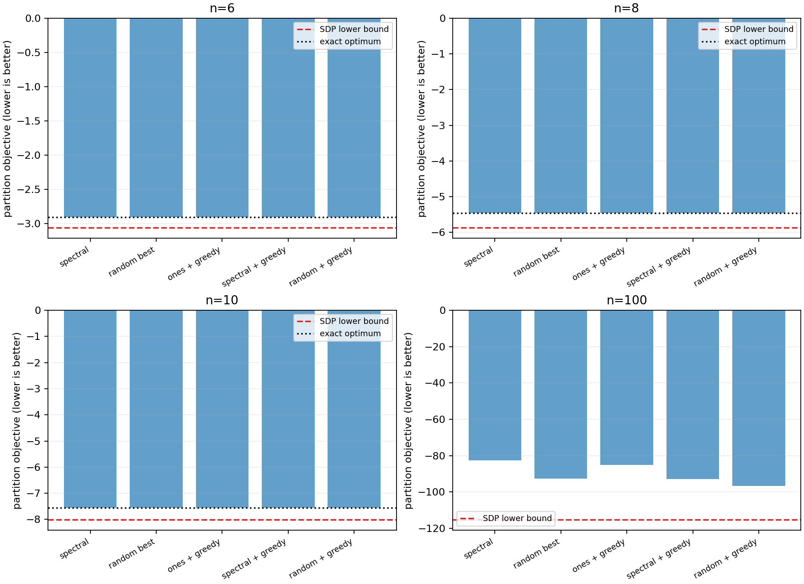
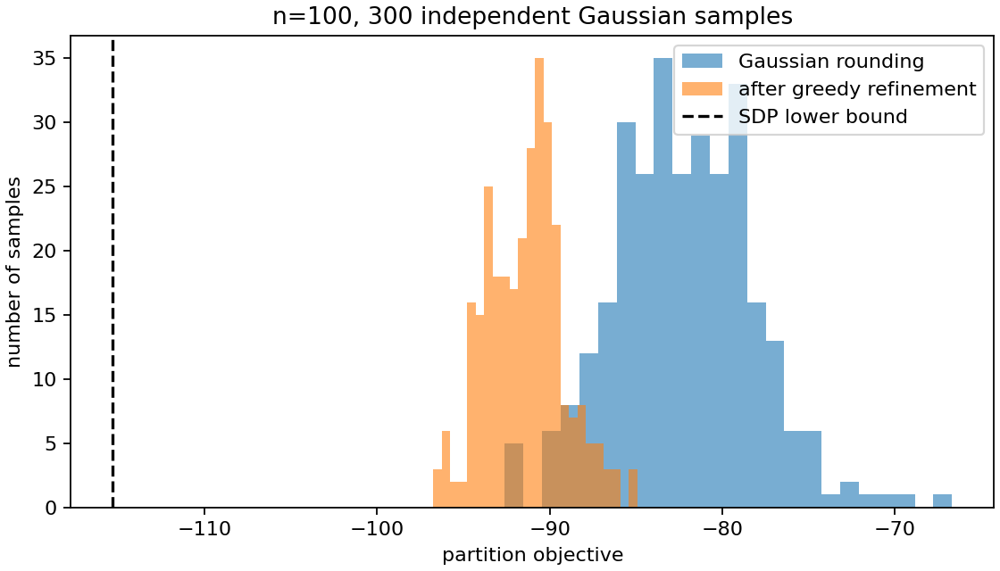

# Exercise 11.23 — SDP bounds and partitioning heuristics

**Source:** Boyd and Vandenberghe, *Convex Optimization*, exercise 11.23(a–d), printed pp. 629–630 ([official book](https://web.stanford.edu/~boyd/cvxbook/bv_cvxbook.pdf)). The implementations and experiments here are original. All matrices use the stipulated symmetric, zero-diagonal convention.

## (a) Solve the two SDPs with a barrier method

The partition problem minimizes $`x^TWx`$ over sign vectors. Its dual lower-bound problem is

```math
\max_\nu -\mathbf1^T\nu\quad\text{subject to}\quad S=W+\mathrm{diag}(\nu)\succeq0.
```

Equivalently minimize $`\mathbf1^T\nu`$, adding the semidefinite barrier:

```math
F_t(\nu)=t\mathbf1^T\nu-\log\det S,\qquad S\succ0.
```

Set $`K=S^{-1}`$. Matrix differentiation gives the particularly inexpensive derivatives

```math
(\nabla F_t)_i=t-K_{ii},\qquad
(\nabla^2F_t)_{ij}=K_{ij}^2.
```

Thus the Hessian is the Hadamard square $`K\circ K`$, not the matrix product $`K^2`$. The Newton direction solves

```math
(K\circ K)\Delta\nu=\mathrm{diag}(K)-t\mathbf1.
```

The code uses Cholesky to evaluate the log determinant and inverse, then solves this $`n`$-by-$`n`$ Newton system. Cholesky failure on a trial $`S`$ means it is outside the domain, so Armijo backtracking reduces the step. Each iteration has dense $`O(n^3)`$ cost and $`O(n^2)`$ storage. There is no need to optimize over $`n(n+1)/2`$ matrix coordinates.

A strict start is $`\nu=\alpha\mathbf1`$, where $`\alpha=\max\{1,1-\lambda_{\min}(W)\}`$. The outer update is $`t\leftarrow10t`$, capped at the target. We use nominal gaps $`10^{-5}`$ for the small examples and $`10^{-3}`$ for $`n=100`$.

### Recover the other SDP's solution

At an exact center, define

```math
X=\frac1t(W+\mathrm{diag}(\nu))^{-1}.
```

Then $`X\succ0`$, $`X_{ii}=1`$ by stationarity, and $`SX=I/t`$. Consequently the two SDP objective values differ by

```math
\mathrm{tr}(WX)+\mathbf1^T\nu
=\mathrm{tr}(SX)=n/t.
```

In floating point we do not pretend finite centering makes the diagonal exactly one. Compute $`X_{\rm raw}=K/t`$, $`D=\mathrm{diag}((X_{\rm raw})_{11},\ldots,(X_{\rm raw})_{nn})`$, and use the congruence scaling

```math
\widetilde X=D^{-1/2}X_{\rm raw}D^{-1/2}.
```

This preserves positive semidefiniteness and gives unit diagonal to floating-point precision. The implementation reports both cone minimum eigenvalues, the raw and corrected diagonal residuals, and the **measured** feasible SDP gap

```math
\mathrm{tr}(W\widetilde X)-(-\mathbf1^T\nu).
```

The dual value $`-\mathbf1^T\nu`$ is a valid lower bound on the discrete optimum. A primal SDP value is an upper bound on the relaxed optimum; it is not automatically a lower bound on the discrete optimum.

### Small and large tests

For $`n=6,8,10`$, exhaustive enumeration fixes the first sign to $`+1`$ and tests all $`2^{n-1}`$ representatives. This is exactly equivalent to evaluating all $`2^n`$ vectors, because the objective is invariant under a global sign reversal. The $`n=100`$ instance is solved at its full dimension; enumerating $`2^{99}`$ representatives is explicitly skipped. It is not replaced by a small instance.

CVXPY independently solves the primal SDP, using CLARABEL for small examples and SCS for $`n=100`$. The custom solver's feasibility checks and two-sided SDP gap are independent of the reference solver's accuracy.

## (b) Spectral rounding

Let $`v`$ be a unit eigenvector corresponding to the largest eigenvalue of $`\widetilde X`$. Return $`\widehat x_i=1`$ when $`v_i\ge0`$, and $`-1`$ otherwise. The deterministic convention at zero always produces a feasible partition. The implementation fixes the eigenvector orientation by making its largest-magnitude entry positive. When there are no zero entries, changing the global sign simply reverses the partition and leaves its objective unchanged.

For every result, evaluate the original quadratic objective $`\widehat x^TW\widehat x`$ and compare it to the feasible dual lower bound. No rank-one assumption is made when using the heuristic. If the optimal SDP matrix actually is rank one, its factor provides an optimal sign vector, which motivates this construction.

## (c) Gaussian rounding

Factor $`\widetilde X=Q\mathrm{diag}(d)Q^T`$. For independent $`z^{(k)}\sim N(0,I)`$, generate

```math
y^{(k)}=Q\mathrm{diag}(\sqrt d)z^{(k)},\qquad
\widehat x^{(k)}=\mathrm{sign}(y^{(k)}).
```

The continuous samples have mean zero and covariance $`\widetilde X`$. Among $`K=300`$ independent sign vectors, return the one with smallest original objective. Only negligible negative eigenvalues caused by roundoff may be clipped when taking a square root; a materially indefinite covariance raises an error. The RNG is local and seeded.

## (d) Greedy one-coordinate refinement

Let $`x'=x-2x_ie_i`$. Expanding the objective gives

```math
f(x')-f(x)=-4x_i(Wx)_i+4W_{ii}=-4x_i(Wx)_i,
```

using the exercise's $`W_{ii}=0`$. Choose the most negative coordinate change, flip that sign, and repeat while a strict reduction remains. The product $`Wx`$ is updated by

```math
Wx' = Wx-2x_iW_{:i},
```

where $`x_i`$ is the old sign. Each candidate scan and product update costs $`O(n)`$ after the initial matrix-vector multiplication. The routine records the true objective after every flip and checks the final best possible one-bit change. It terminates at a one-bit local minimum, which need not be globally optimal.

The experiment refines **all** required starts: the all-ones partition, the spectral result, and every one of the 300 Gaussian-rounded partitions. It reports both refinement of the originally best random sample and the best outcome over all refined samples. These need not coincide.

<!-- BEGIN GENERATED RESULTS -->
## Executed results

The full-size experiment was executed at **2026-10-10T03:19:29.844480Z**, with seed **0** and Python **3.12.14**. The tables below are generated directly from this run's [recorded output](../../artifacts/11.23/results.json), rather than illustrative or expected values. See the [execution record](../../coverage/results-refresh.json) for the exact command, package versions, source fingerprint, and checks.

### (a) Both SDP solutions and their certificates

| n | Dual lower bound | Primal SDP value | Measured SDP gap | Nominal n/t | Newton steps |
| --- | --- | --- | --- | --- | --- |
| 6 | -3.06159663821 | -3.06158663821 | 1.000e-05 | 1.000e-05 | 40 |
| 8 | -5.87114028699 | -5.87113028699 | 1.000e-05 | 1.000e-05 | 34 |
| 10 | -8.01566867557 | -8.01565867557 | 1.000e-05 | 1.000e-05 | 38 |
| 100 | -115.314248333 | -115.313248333 | 1.000e-03 | 1.000e-03 | 37 |

| n | Smallest dual eigenvalue | Smallest primal eigenvalue | Raw diagonal residual | Corrected diagonal residual | Complementarity norm |
| --- | --- | --- | --- | --- | --- |
| 6 | 3.552e-07 | 1.555e-06 | 3.553e-07 | 2.220e-16 | 4.082e-06 |
| 8 | 2.448e-07 | 6.665e-07 | 9.756e-08 | 2.220e-16 | 3.536e-06 |
| 10 | 1.742e-07 | 4.986e-07 | 1.038e-08 | 2.220e-16 | 3.162e-06 |
| 100 | 3.554e-07 | 3.796e-06 | 1.089e-08 | 2.220e-16 | 1.000e-04 |

Both reported SDP matrices are positive definite and the normalized primal diagonal is one to roundoff. The lower and upper objective columns bracket the relaxed optimum; only the dual column is a lower bound for the discrete problem.

| n | Independent solver / status | Reference SDP objective | Reference diagonal residual | Reference minimum eigenvalue |
| --- | --- | --- | --- | --- |
| 6 | CLARABEL / optimal | -3.06159318898 | 0 | 1.668e-08 |
| 8 | CLARABEL / optimal | -5.87113766991 | 0 | 8.861e-10 |
| 10 | CLARABEL / optimal | -8.01566560884 | 7.105e-15 | 1.007e-09 |
| 100 | SCS / optimal | -115.314176925 | 4.106e-09 | -1.013e-06 |

SCS reports an optimal status for n = 100 but its small negative minimum eigenvalue is an approximate-cone residual. The certificate uses the custom solver's separately checked feasible pair, not the SCS status.

| n | Exact-search representatives evaluated | Exact discrete optimum |
| --- | --- | --- |
| 6 | 32 | -2.90413718772 |
| 8 | 128 | -5.46352851918 |
| 10 | 512 | -7.55593065016 |
| 100 | Not enumerated (2^99 representatives) | Unknown |

### (b–c) Spectral and Gaussian rounding

| n | Spectral objective | Gaussian samples | Best Gaussian objective | Best Gaussian minus lower bound |
| --- | --- | --- | --- | --- |
| 6 | -2.90413718772 | 300 | -2.90413718772 | 0.1574594505 |
| 8 | -5.46352851918 | 300 | -5.46352851918 | 0.4076117678 |
| 10 | -7.55593065016 | 300 | -7.55593065016 | 0.4597380254 |
| 100 | -82.6277837509 | 300 | -92.6054384729 | 22.70880986 |

Every rounded result is a feasible sign vector. The last column bounds the best Gaussian partition's absolute suboptimality; it need not be close to the SDP optimization gap.

### (d) Greedy refinement of every required start

| n | All ones before | All ones after | Spectral after | Originally best Gaussian after | Best over all refined Gaussian samples |
| --- | --- | --- | --- | --- | --- |
| 6 | -2.04236288414 | -2.90413718772 | -2.90413718772 | -2.90413718772 | -2.90413718772 |
| 8 | -1.95369192388 | -5.46352851918 | -5.46352851918 | -5.46352851918 | -5.46352851918 |
| 10 | 3.51636230037 | -7.55593065016 | -7.55593065016 | -7.55593065016 | -7.55593065016 |
| 100 | 10.0864530316 | -85.0804792137 | -92.7818175616 | -94.8795311897 | -96.7497506624 |

| n | All-ones flips | Spectral flips | Winning refined sample flips | Winner's best remaining flip change | Mean Gaussian improvement |
| --- | --- | --- | --- | --- | --- |
| 6 | 2 | 0 | 1 | 7.438e-01 | 0.5055919054 |
| 8 | 2 | 0 | 1 | 7.878e-01 | 0.5828871713 |
| 10 | 7 | 0 | 0 | 1.096e+00 | 0.9804117713 |
| 100 | 46 | 12 | 3 | 9.573e-02 | 9.137751703 |

The winning refined sample need not come from the originally best Gaussian draw. Each displayed final best-flip change is nonnegative, verifying a one-coordinate local minimum for the winner. All 300 Gaussian samples are refined, and the JSON retains every raw and refined objective plus the displayed winners' histories.

For n = 100, the best reported partition has objective -96.7497506624, with 55 positive and 45 negative signs. Its certified absolute suboptimality bound is 18.5644976701. The discrete optimum is unknown at this size. The small instances' best rounded results reach their enumerated optima.

The linked JSON contains every generated W, SDP matrix, multiplier, and winning sign vector, including the full 100-by-100 instance.




<!-- END GENERATED RESULTS -->

## Reproduce and test

Run `convex-solutions run 11.23 --output artifacts/11.23 --seed 0`. Outputs include:

- `results.json`: generated $`W`$, both SDP solutions, certificates, all heuristic costs, the winners, refinement histories, and independent-solver metadata
- `partition_heuristics.png`: all small/large comparisons and lower bounds
- `randomized_greedy_distribution.png`: the $`n=100`$ distribution before and after refinement

Tests finite-difference both derivatives; verify the feasible primal/dual SDP pair; enumerate small optima; run the full $`n=100`$ experiment; check the single-flip identity, monotonicity, and one-bit terminal condition; and test the covariance construction on a rank-one matrix.
