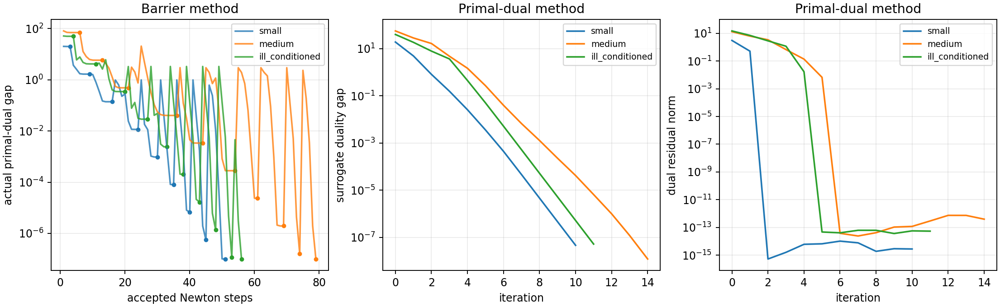

# Exercise 11.24 — Barrier and primal-dual methods for QPs

**Source:** Boyd and Vandenberghe, *Convex Optimization*, exercise 11.24, printed p. 630 ([official book](https://web.stanford.edu/~boyd/cvxbook/bv_cvxbook.pdf)). Both iterative algorithms below are implemented directly; CVXPY is used only as an independent reference.

We solve

```math
\min_x\ f_0(x)=\tfrac12x^TPx+q^Tx\quad\text{subject to}\quad Ax\preceq b,
```

where $`P\succeq0`$, from a supplied strict feasible point. Write $`s=b-Ax\succ0`$.

## Barrier method

The centering objective and derivatives are

```math
F_t(x)=tf_0(x)-\sum_i\log s_i,
```

```math
\nabla F_t=t(Px+q)+A^Ts^{-1},\qquad
\nabla^2F_t=tP+A^T\mathrm{diag}(s^{-2})A.
```

Solve $`\nabla^2F_t\Delta x=-\nabla F_t`$, then backtrack until the trial slack is positive and the Armijo decrease condition holds. Stop centering when half the squared Newton decrement is at most $`10^{-10}`$, update $`t\leftarrow12t`$, and continue until $`m/t\le10^{-7}`$. The strict initial point is checked before starting.

The recovered multipliers are $`\lambda_i=1/(ts_i)`$. The complementarity sum is always $`s^T\lambda=m/t`$, but at an approximate center there may be a nonzero stationarity residual. We therefore plot a measured primal-dual gap rather than claiming that the nominal central-path number alone proves convergence.

For the positive-definite experimental matrices, every nonnegative $`\lambda`$ is dual feasible and

```math
g(\lambda)=-\tfrac12(q+A^T\lambda)^TP^{-1}(q+A^T\lambda)-b^T\lambda.
```

The plotted gap is $`f_0(x)-g(\lambda)`$. If $`r_d=Px+q+A^T\lambda`$, then

```math
f_0(x)-g(\lambda)=s^T\lambda+\tfrac12r_d^TP^{-1}r_d,
```

which explicitly shows the finite-centering correction. The implementation records this actual gap after every accepted Newton step, including intermediate points that are not yet centered. Centered stages are marked in the figure.

## Primal-dual interior-point method

Initialize $`\lambda=\mathbf1`$ and retain the supplied strictly feasible $`x`$. At each iteration define

```math
\eta=s^T\lambda,\qquad t=\mu m/\eta,\quad\mu=10,
```

```math
r_d=Px+q+A^T\lambda,\qquad
r_c=\mathrm{diag}(\lambda)s-(1/t)\mathbf1.
```

Linearizing the residual gives the Newton equations

```math
\begin{bmatrix}
P&A^T\\
-\mathrm{diag}(\lambda)A&\mathrm{diag}(s)
\end{bmatrix}
\begin{bmatrix}\Delta x\\\Delta\lambda\end{bmatrix}
=-\begin{bmatrix}r_d\\r_c\end{bmatrix}.
```

Eliminating $`\Delta\lambda`$ yields a symmetric reduced system:

```math
\left(P+A^T\mathrm{diag}(\lambda/s)A\right)\Delta x
=-r_d+A^T(r_c/s),
```

```math
\Delta\lambda=(-r_c+\lambda\odot(A\Delta x))/s.
```

The code restricts the step to 99% of the first boundary crossing for both $`\lambda`$ and $`s`$, then backtracks until the norm of the combined residual decreases. During that line search, $`t`$ is held fixed. Updating $`t`$ at each trial would change the merit function and is not the implemented algorithm. The stop condition requires both $`\eta\le10^{-7}`$ and $`\|r_d\|_2\le10^{-7}`$.

## Semidefinite and degenerate cases

Positive definite $`P`$ is not required for either iteration. The Newton matrix is positive definite whenever there is no common null direction of $`P`$ and $`A`$. If compatible flat directions make it singular, the shared solver computes a minimum-norm Newton step using a rank-revealing eigen decomposition and checks the system residual. It does not silently add an objective-changing ridge. An incompatible gradient along a flat direction raises an explicit error.

For singular $`P`$, a finite dual objective additionally requires $`q+A^T\lambda\in\mathrm{range}(P)`$. A small residual is not that exact condition. The implementation therefore returns no claimed exact dual objective/gap for these fixtures; it still returns primal feasibility, complementarity, and stationarity. Tests include a genuinely rank-deficient $`P`$, an optimum on the box boundary, and a redundant unconstrained coordinate whose original value should stay unchanged.

As usual, a strictly feasible start does not imply existence of a finite optimum. Iteration limits and incompatible systems are reported as failures rather than false optimal results; the code is a dense educational implementation, not a homogeneous infeasibility/unboundedness certificate solver.

## Experiments

Three seeded positive-definite examples include dimensions $`(n,m)=(5,20),(20,70),(12,50)`$ and Hessian condition numbers 3, 20, and 1000. Random inequality rows plus box constraints ensure bounded feasible sets, and $`x^{(0)}=0`$ is strict. All arrays are saved. An independent CLARABEL solve checks each objective.

<!-- BEGIN GENERATED RESULTS -->
## Executed results

The full-size experiment was executed at **2026-10-10T03:19:30.395001Z**, with seed **0** and Python **3.12.14**. The tables below are generated directly from this run's [recorded output](../../artifacts/11.24/results.json), rather than illustrative or expected values. See the [execution record](../../coverage/results-refresh.json) for the exact command, package versions, source fingerprint, and checks.

### Both directly implemented algorithms

| Instance | Method | Accepted steps / iterations | Primal objective | Dual objective | Actual duality gap | Complementarity sum |
| --- | --- | --- | --- | --- | --- | --- |
| small | Barrier | 51 | -2.648335282858 | -2.648335382858 | 1.000e-07 | 1.000e-07 |
| small | Primal-dual | 10 | -2.648335290951 | -2.648335336993 | 4.604e-08 | 4.604e-08 |
| medium | Barrier | 79 | -13.88756137502 | -13.88756147502 | 1.000e-07 | 1.000e-07 |
| medium | Primal-dual | 14 | -13.88756138624 | -13.88756139833 | 1.209e-08 | 1.209e-08 |
| ill_conditioned | Barrier | 56 | -11.58295467584 | -11.58295477584 | 1.000e-07 | 1.000e-07 |
| ill_conditioned | Primal-dual | 11 | -11.58295467968 | -11.58295473169 | 5.201e-08 | 5.201e-08 |

The barrier iteration count is the total number of accepted inner Newton steps. The primal-dual count is the number of outer primal-dual steps. The actual gap includes the stationarity correction; the complementarity column is the surrogate gap used by the primal-dual stopping test.

### Independent QP comparisons

| Instance | n × m | Reference objective | Barrier objective error | Primal-dual objective error | Reference / status |
| --- | --- | --- | --- | --- | --- |
| small | 5 × 20 | -2.648335297811 | 1.495e-08 | 6.860e-09 | CLARABEL / optimal |
| medium | 20 × 70 | -13.88756138787 | 1.285e-08 | 1.629e-09 | CLARABEL / optimal |
| ill_conditioned | 12 × 50 | -11.58295468382 | 7.976e-09 | 4.136e-09 | CLARABEL / optimal |

### Feasibility, residuals, and solution errors

| Instance | Method | Primal violation | Minimum slack | Minimum multiplier | Stationarity norm | Point error vs reference |
| --- | --- | --- | --- | --- | --- | --- |
| small | Barrier | 0 | 4.154e-09 | 2.589e-09 | 4.877e-08 | 5.942e-08 |
| small | Primal-dual | 0 | 1.913e-09 | 1.192e-09 | 2.762e-15 | 2.694e-08 |
| medium | Barrier | 0 | 3.593e-10 | 7.062e-10 | 2.042e-06 | 4.043e-07 |
| medium | Primal-dual | 0 | 4.311e-11 | 8.473e-11 | 3.916e-13 | 7.312e-08 |
| ill_conditioned | Barrier | 0 | 4.003e-10 | 9.208e-10 | 3.262e-06 | 4.394e-09 |
| ill_conditioned | Primal-dual | 0 | 2.082e-10 | 4.789e-10 | 5.349e-14 | 2.267e-09 |

All returned slacks and multipliers are strictly positive. The barrier's decrement stopping rule allows a larger stationarity residual than the primal-dual rule; the evaluated positive-definite dual objective includes its contribution.

Final primal-dual x for **small**: (0.0872225625, 0.23466453, 0.80921218, 0.430997655, -0.277053665).

Final primal-dual x for **medium**: (-0.576240287, -0.257277982, 0.615220751, 0.199043012, 0.140729036, 0.29094735, -0.0422585435, -0.607516707, -0.184846161, 0.568864172, -0.0433333293, -0.0514658735, 0.301917297, -0.326704137, 0.00617130332, 0.610091608, -0.537052077, -0.84594697, 0.845253454, 0.164549157).

Final primal-dual x for **ill_conditioned**: (-0.142579028, 0.144332181, 0.127814906, 0.493083589, -0.341247131, 0.482215037, -0.634315549, 0.655852818, 0.520066481, -0.672890254, -0.334724995, -0.630587877).

All barrier and reference solution coordinates, input matrices, and complete convergence histories are in the linked JSON.


<!-- END GENERATED RESULTS -->

## Reproduce and inspect

Run `convex-solutions run 11.24 --output artifacts/11.24 --seed 0`.

`qp_convergence.png` contains all requested plots: actual barrier duality gap versus accepted Newton steps; primal-dual surrogate duality gap versus iteration; and primal-dual dual-residual norm versus iteration. `results.json` contains all input matrices, iterates' metrics, final primal/dual values, and independent reference solutions.

Tests finite-difference the barrier oracle, compare both algorithms against CLARABEL on two seeds, verify strict slack/multiplier positivity and dual lower bounds, exercise the PSD and flat-coordinate fixtures, and reject indefinite Hessians or non-strict initial points.
