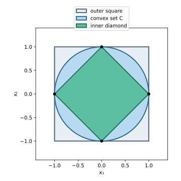

# Exercise 2.25: Inner and outer polyhedral approximations

Source: Boyd and Vandenberghe, [Convex Optimization, exercise 2.25, p. 63](https://web.stanford.edu/~boyd/cvxbook/bv_cvxbook.pdf#page=77).

Original solution.

Closure of $`C`$ ensures that each selected boundary point belongs to $`C`$. Convexity then ensures that every convex combination of them belongs to $`C`$, so $`P_{\mathrm{inner}}\subseteq C`$. Every supporting halfspace contains $`C`$ by hypothesis; intersecting those halfspaces gives $`C\subseteq P_{\mathrm{outer}}`$. Therefore
```math
P_{\mathrm{inner}}\subseteq C\subseteq P_{\mathrm{outer}}.
```
The outer polyhedron may be unbounded, and neither inclusion need be strict.



In this example $`C`$ is the unit disk and the sampled boundary points are $`(\pm1,0),(0,\pm1)`$. The inner polyhedron is the diamond $`|x_1|+|x_2|\le1`$; the outer one is the square $`|x_i|\le1`$. Thus the picture displays both inclusions with exact geometry.
