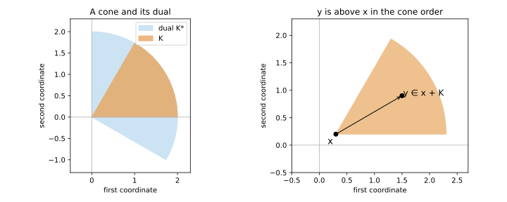

# Exercise 2.29: Planar cones, duality, and generalized order

Source: Boyd and Vandenberghe, [Convex Optimization, exercise 2.29, p. 64](https://web.stanford.edu/~boyd/cvxbook/bv_cvxbook.pdf#page=78).

Original solution.

## (a) Classification

A nonempty closed convex cone in the plane is one of: $`\{0\}`$, the whole plane, a line through zero, or a closed angular sector
```math
K=\{r(\cos\phi,\sin\phi):r\ge0,\ \alpha\le\phi\le\beta\},
\qquad 0\le\beta-\alpha\le\pi.
```
An angular interval of width zero is a ray, and width $`\pi`$ is a halfplane. To justify exhaustiveness, a cone not equal to the whole plane is contained in a closed halfplane by separation from an exterior point. Within that halfplane its directions fill an interval by convexity, unless it consists only of the two opposite boundary rays, which is the line case. Closure includes the interval endpoints.

## (b) Dual cone

For a sector as above, a direction $`\psi`$ has nonnegative inner product with every direction in $`[\alpha,\beta]`$ exactly when
```math
\beta-\pi/2\le\psi\le\alpha+\pi/2.
```
So the dual sector has width $`\pi-(\beta-\alpha)`$ and the same bisector. The dual of a line is its perpendicular line; the dual of $`\{0\}`$ is the plane, and the dual of the plane is $`\{0\}`$.



The left panel uses $`K`$ with angles $`[0,\pi/3]`$, whose dual has angles $`[-\pi/6,\pi/2]`$. The right panel uses the same $`K`$ translated to a point $`x`$.

## (c) Pointedness

The cone is pointed exactly when it is $`\{0\}`$ or an angular sector of width strictly less than $`\pi`$. Those sets contain no pair of nonzero opposite vectors. A line, halfplane, or the whole plane contains a line and is not pointed.

## (d) Proper cones and order

A planar cone is proper exactly when it is a sector with $`0<\beta-\alpha<\pi`$: positive width gives nonempty interior, width less than $`\pi`$ gives pointedness, and closure and convexity already hold. For such a cone,
```math
x\preceq_K y\quad\Longleftrightarrow\quad y\in x+K.
```
In the right panel the entire shaded translated sector consists of points above $`x`$ in this order. Strict inequality means that $`y-x`$ has positive radius and an angle strictly between the two boundary directions.
