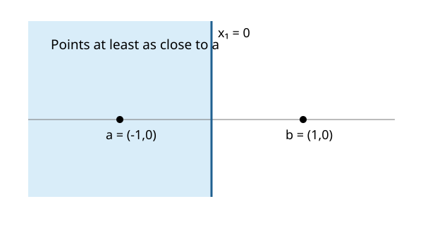

# Exercise 2.7: A distance comparison is a halfspace

Source: Boyd and Vandenberghe, [Convex Optimization, exercise 2.7, p. 60](https://web.stanford.edu/~boyd/cvxbook/bv_cvxbook.pdf#page=74).

Original solution.

Both distances are nonnegative, so squaring preserves the comparison. Cancellation yields
```math
\|x-a\|_2^2\le\|x-b\|_2^2
\quad\Longleftrightarrow\quad
2(b-a)^Tx\le\|b\|_2^2-\|a\|_2^2.
```
Thus take $`c=2(b-a)`$ and $`d=\|b\|_2^2-\|a\|_2^2`$. The normal is nonzero because $`a\ne b`$. The boundary passes through $`(a+b)/2`$ and is perpendicular to $`b-a`$; the accepted side contains $`a`$.



The two-dimensional illustration uses $`a=(-1,0)`$ and $`b=(1,0)`$, so the region is $`x_1\le0`$. In higher dimensions the same argument gives a perpendicular-bisector hyperplane.
