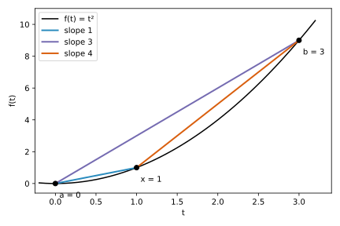

# Exercise 3.1: Secant slopes and derivatives of a convex function

Source: Boyd and Vandenberghe, [Convex Optimization, exercise 3.1, p. 113](https://web.stanford.edu/~boyd/cvxbook/bv_cvxbook.pdf#page=127).

Original solution.

## (a) The chord bound

For $`x\in[a,b]`$, write $`x=((b-x)/(b-a))a+((x-a)/(b-a))b`$. These coefficients are nonnegative and sum to one, so convexity gives the claimed chord upper bound on $`f(x)`$.

## (b) Ordered secant slopes

For $`a<x<b`$, subtract $`f(a)`$ from the chord bound and divide by $`x-a>0`$ to obtain
```math
\frac{f(x)-f(a)}{x-a}\le\frac{f(b)-f(a)}{b-a}.
```
Rearranging the same chord bound as a lower bound on $`f(b)-f(x)`$ and dividing by $`b-x>0`$ gives
```math
\frac{f(b)-f(a)}{b-a}\le\frac{f(b)-f(x)}{b-x}.
```



The illustration uses $`f(t)=t^2`$ at $`a=0,x=1,b=3`$: the three slopes are $`1,3,4`$, respectively.

## (c) Derivative bounds

In the first inequality let $`x\downarrow a`$; differentiability gives the left endpoint derivative. In the second let $`x\uparrow b`$ to get the right endpoint derivative. Hence
```math
f'(a)\le\frac{f(b)-f(a)}{b-a}\le f'(b).
```
At a domain endpoint these limits use the appropriate one-sided derivative if that is the intended convention.

## (d) Nonnegative second derivative

Applying (c) to any two domain points shows that $`f'`$ is nondecreasing. For small $`h>0`$,
```math
\frac{f'(a+h)-f'(a)}h\ge0,
\qquad
\frac{f'(b)-f'(b-h)}h\ge0.
```
Taking limits gives $`f''(a)\ge0`$ and $`f''(b)\ge0`$ whenever the indicated second derivatives exist. This uses inward limits and hence also covers endpoints when second derivatives there are understood one-sidedly.
