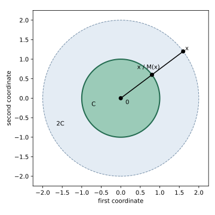

# Exercise 3.34: The Minkowski functional and norms

Source: Boyd and Vandenberghe, [Convex Optimization, exercise 3.34, p. 119](https://web.stanford.edu/~boyd/cvxbook/bv_cvxbook.pdf#page=133).

Original solution.

Use $`\inf\varnothing=+\infty`$ and write $`M_C(x)=\inf\{t>0:x\in tC\}`$.

## (a) Geometric interpretation

Dilate $`C`$ about the origin until the dilated set first reaches $`x`$; the infimum dilation factor is $`M_C(x)`$. Equivalently, on the ray through $`x`$, find the furthest available point of $`C`$ in the gauge sense and compare radial scales. An infimum need not be attained if $`C`$ is not closed.



The picture uses the unit disk and $`x=(1.6,1.2)`$, for which $`M_C(x)=2`$ and $`x/2=(0.8,0.6)`$ lies on its boundary.

## (b) Homogeneity

For $`\alpha>0`$, substitution $`t=\alpha s`$ gives $`M_C(\alpha x)=\alpha M_C(x)`$. At scale zero, $`M_C(0)=0`$ if $`0\in C`$, and $`M_C(0)=+\infty`$ otherwise. Thus the assertion for all $`\alpha\ge0`$ requires the usual gauge assumption $`0\in C`$ (and the conventional extended-value treatment at zero). The source states only convexity of $`C`$ in parts (a)–(d); for $`C=\{1\}\subset\mathbb R`$, $`M_C(1)=1`$ but $`M_C(0)=+\infty`$, showing the omitted qualification.

## (c) Domain

The exact effective domain is
```math
\mathrm{dom}\,M_C=\bigcup_{t>0}tC.
```
If $`0\in C`$, this is its conic hull. Without that assumption zero need not belong, so adjoining zero without comment would change the answer. Empty $`C`$ gives an empty domain.

## (d) Convexity

Suppose $`x\in sC`$, $`y\in tC`$ with $`s,t>0`$, and put $`r=\theta s+(1-\theta)t>0`$. Then
```math
\frac{\theta x+(1-\theta)y}{r}
=\frac{\theta s}{r}\frac xs+
\frac{(1-\theta)t}{r}\frac yt\in C.
```
Consequently $`M_C(\theta x+(1-\theta)y)\le\theta s+(1-\theta)t`$. Choose $`s,t`$ arbitrarily close to their respective nonnegative infima to prove convexity, with no origin-membership or closure assumption needed.

## (e) Norm and unit ball

Under the extra hypotheses, symmetry and convexity imply $`0\in C`$. In fact $`0`$ is interior: if $`B(a,r)\subseteq C`$, then symmetry gives $`B(-a,r)\subseteq C`$, and averaging these balls puts $`B(0,r)\subseteq C`$. Boundedness also gives $`C\subseteq B(0,R)`$ for some finite $`R`$. Therefore
```math
\|x\|_2/R\le M_C(x)\le\|x\|_2/r.
```
Thus the functional is finite and is zero only at zero. Symmetry and positive homogeneity yield absolute homogeneity. Convexity and homogeneity give the triangle inequality:
$`M_C(x+y)=2M_C((x+y)/2)\le M_C(x)+M_C(y)`$. Hence it is a norm.

Its closed unit ball is exactly $`C`$. Membership in $`C`$ implies gauge at most one. Conversely, if the gauge is at most one, choose $`t_j>0`$ with $`x/t_j\in C`$ and $`t_j\to M_C(x)`$. For nonzero $`x`$ the limit is positive by the lower norm bound; closure yields $`x/M_C(x)\in C`$, and convexity with zero then gives $`x\in C`$. Zero is already in $`C`$.
