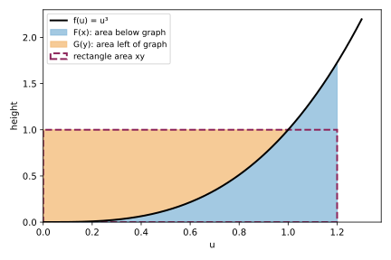

# Exercise 3.38: Inverse-function integrals and Young inequality

Source: Boyd and Vandenberghe, [Convex Optimization, exercise 3.38, p. 120](https://web.stanford.edu/~boyd/cvxbook/bv_cvxbook.pdf#page=134).

Original solution.

Interpret the inverse as that of a continuous strictly increasing function, with $`f(0)=0`$. The inverse $`g`$ is defined on the range interval of $`f`$; if the intended domains are all of $`\mathbb R`$, this assumes $`f`$ is onto. Without an interval-valued inverse domain, the written integral defining $`G`$ would need further specification.

Since $`F'=f`$ is increasing, $`F`$ is convex. For a value $`y`$ in the inverse domain, the derivative of $`xy-F(x)`$ with respect to $`x`$ is $`y-f(x)`$, positive before $`x=g(y)`$ and negative after. Thus
```math
F^*(y)=y g(y)-F(g(y)).
```
The inverse-area identity gives
```math
F(g(y))+G(y)=y g(y),
```
so $`F^*(y)=G(y)`$. One analytic justification not requiring differentiability of $`g`$ is to use the maximizing inequalities at $`y`$ and $`y+h`$: the difference quotient of $`F^*`$ is squeezed between $`g(y)`$ and $`g(y+h)`$. Continuity of the inverse implies $`(F^*)'=g`$; its value at zero is zero, so integrating yields $`F^*=G`$.

Conversely, $`G'=g`$ is increasing, and maximizing $`xy-G(y)`$ gives $`y=f(x)`$ by the same sign argument. The same identity gives $`G^*(x)=F(x)`$. If $`f`$ has a finite limiting range endpoint, the full extended-valued conjugate is obtained by the corresponding endpoint limit of $`G`$, possibly infinite; an open-domain formula alone should not omit such finite boundary values.

The definition of the conjugate now gives Young's inequality
```math
xy\le F(x)+G(y),
```
with equality exactly when $`y=f(x)`$ (equivalently $`x=g(y)`$). For positive coordinates, the geometric interpretation is that the area beneath $`f`$ from zero to $`x`$, plus the area to the left of its graph from height zero to $`y`$, covers the $`x`$-by-$`y`$ rectangle; any excess is the gap in the inequality. Signed integrals extend the identity to negative coordinates.



The illustrative graph is $`f(x)=x^3`$, with $`x=1.2,y=1`$. It shows the two areas whose sum is at least the rectangle area; it does not serve as the proof for general increasing functions.
