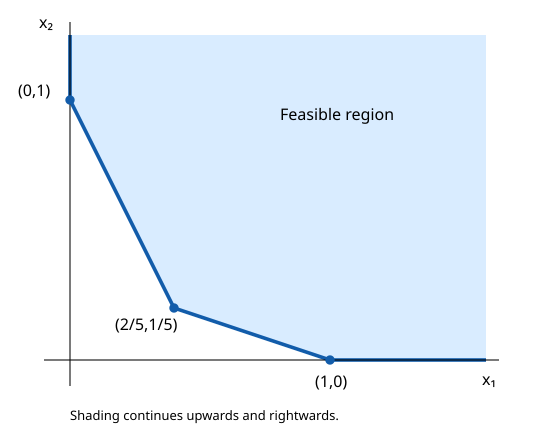

# Exercise 4.1: Planar objective comparisons

Source: [Boyd and Vandenberghe, Convex Optimization, exercise 4.1](https://web.stanford.edu/~boyd/cvxbook/bv_cvxbook.pdf#page=203). The source exercise and all of its subparts were checked directly.

## Feasible set

The lower-left boundary consists of the ray from $`(0,1)`$ upwards, the segment from $`(0,1)`$ to $`(2/5,1/5)`$, the segment from there to $`(1,0)`$, and the ray from $`(1,0)`$ rightwards. The feasible region is northeast of this boundary; its recession cone is the nonnegative orthant.



## (a) Sum

Adding one fifth of the second inequality to two fifths of the first gives $`x_1+x_2\ge3/5`$. Equality requires both original inequalities to be tight, so the unique minimizer is $`(2/5,1/5)`$ and the value is $`3/5`$.

## (b) Negative sum

The feasible sequence $`(t,0)`$, $`t\ge1`$, has value $`-t\to-\infty`$. The optimal value is $`-\infty`$ and the optimal set is empty.

## (c) First coordinate

Nonnegativity gives value at least zero. Precisely the points $`(0,s)`$ with $`s\ge1`$ achieve it. Thus the optimal set is that ray and the value is zero.

## (d) Largest coordinate

Writing $`t=\max(x_1,x_2)`$, the first constraint implies $`1\le2x_1+x_2\le3t`$. At $`t=1/3`$, equality forces $`x_1=x_2=1/3`$, which also satisfies the second constraint. This is the unique minimizer; the value is $`1/3`$.

## (e) Weighted square

Cauchy–Schwarz gives

```math
x_1^2+9x_2^2\ge\frac{(x_1+3x_2)^2}{2}\ge\frac12.
```

Equality holds exactly when $`x_1=3x_2`$ and $`x_1+3x_2=1`$. This gives $`(1/2,1/6)`$, which satisfies the first constraint strictly. Therefore the unique optimum is $`(1/2,1/6)`$ with value $`1/2`$.

## Validation

All reported finite optimizers were substituted into both halfspace constraints. The SVG is an exact polygonal sketch with a finite plotting window; its upper and right edges are plotting limits, not constraints. No numerical optimizer is needed for these certificates.
