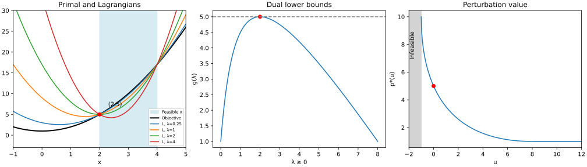

# Exercise 5.1: A scalar primal-dual and sensitivity example

Source: [Boyd and Vandenberghe, Convex Optimization, exercise 5.1](https://web.stanford.edu/~boyd/cvxbook/bv_cvxbook.pdf#page=287). The source exercise and all of its subparts were checked directly.

## (a) Primal problem

The constraint is $`(x-3)^2\le1`$, so the feasible set is $`[2,4]`$. The objective is strictly increasing there; the unique optimizer is $`x^\star=2`$ and $`p^\star=5`$.

## (b) Lagrangian, lower bounds, and graph

The Lagrangian is

```math
L(x,\lambda)=(1+\lambda)x^2-6\lambda x+1+8\lambda.
```

For $`\lambda>-1`$, completing the square gives its minimizing point $`x_\lambda=3\lambda/(1+\lambda)`$ and

```math
g(\lambda)=1+8\lambda-\frac{9\lambda^2}{1+\lambda}
=10-\lambda-\frac9{1+\lambda}.
```

For $`\lambda<-1`$ the quadratic is unbounded below; at $`\lambda=-1`$ it is a nonconstant affine function, so $`g=-\infty`$ there too. For the dual-feasible range $`\lambda\ge0`$,

```math
5-g(\lambda)=\frac{(\lambda-2)^2}{1+\lambda}\ge0.
```

This explicitly verifies the lower-bound property. It also follows directly from $`L(x,\lambda)\le x^2+1`$ on every primal-feasible point.



## (c) Dual optimum

Maximize $`g(\lambda)`$ over $`\lambda\ge0`$. Its second derivative is $`-18/(1+\lambda)^3<0`$, so it is a concave maximization problem. Its derivative vanishes at $`-1+9/(1+\lambda)^2=0`$, giving the unique feasible optimum $`\lambda^\star=2`$ and $`d^\star=5`$. Strong duality holds. Slater also applies, since the primal is convex and $`x=3`$ satisfies its inequality strictly. The Lagrangian minimizer at this multiplier is $`x=2`$, as expected.

## (d) Perturbation and sensitivity

The perturbed feasible set is empty when $`u<-1`$; otherwise it is $`[3-\sqrt{1+u},3+\sqrt{1+u}]`$. Minimizing distance to zero on this interval yields

```math
p^\star(u)=\begin{cases}
+\infty,&u\lt -1,\\
1+(3-\sqrt{1+u})^2,&-1\le u\le8,\\
1,&u\ge8.
\end{cases}
```

For $`-1<u<8`$, its derivative is $`1-3/\sqrt{1+u}`$. Thus $`(p^\star)'(0)=-2=-\lambda^\star`$. At $`u=-1`$ the feasible interval collapses to $`\{3\}`$; at $`u=8`$ it first reaches zero, after which the unconstrained minimizer stays feasible. The graph shows the finite branch and labels the infeasible side.

## Executed validation

The [plot/check script](../../artifacts/exercises/5.1/plot_check.py) evaluates the derived formulas, checks the dual gap identity and sensitivity by central differences, and generates the original SVG. Its [results](../../artifacts/exercises/5.1/checks.json) give a maximum absolute error of $`1.6237\times10^{-15}`$ in the dual-gap identity and a central-difference sensitivity of $`-2.0000000000131024`$, agreeing with the exact value $`-2`$. These numerical checks supplement the analytical proof above.
