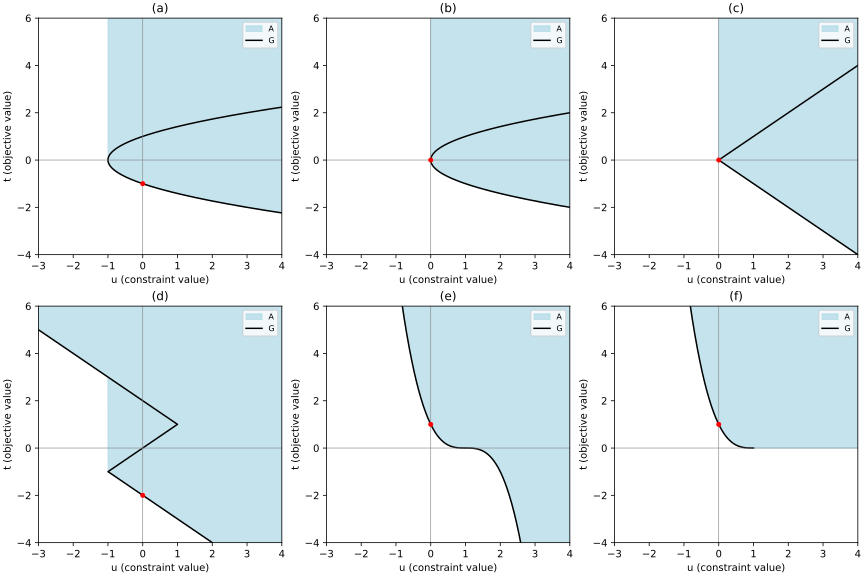

# Exercise 5.22: Six geometries of Lagrange duality

Source: [Boyd and Vandenberghe, Convex Optimization, exercise 5.22](https://web.stanford.edu/~boyd/cvxbook/bv_cvxbook.pdf#page=294). The source exercise and all of its subparts were checked directly.

In every panel below the horizontal coordinate is constraint perturbation $`u=f_1(x)`$, and the vertical coordinate is objective $`t=f_0(x)`$. The black curve is $`G`$; the blue region is the upper image $`A=G+\mathbb R_+^2`$. The formulas specify exact sets beyond the finite drawing windows.



## (a) Quadratic inequality with an interior

Here $`G=\{(t^2-1,t):t\in\mathbb R\}`$ and

```math
A=\{(u,t):u\ge-1,\ t\ge-\sqrt{u+1}\}.
```

The primal optimizer is $`x=-1`$, with value $`-1`$. For $`\lambda>0`$,

```math
g(\lambda)=\inf_x\{x+\lambda(x^2-1)\}=-\lambda-1/(4\lambda),
```

while $`g(0)=-\infty`$. Maximizing over nonnegative multipliers gives $`\lambda^\star=1/2`$, $`d^\star=-1`$. The problem is convex, Slater holds at zero, and strong duality holds with attainment.

## (b) A degenerate quadratic inequality

Here $`G=\{(t^2,t):t\in\mathbb R\}`$ and $`A=\{u\ge0,t\ge-\sqrt u\}`$. The only feasible primal point is zero and $`p^\star=0`$. The dual is $`\sup_{\lambda>0}-1/(4\lambda)=0`$, with $`g(0)=-\infty`$. There is no finite maximizing multiplier; the value is approached as $`\lambda\to\infty`$. The problem is convex but has no strict feasible point. Strong duality holds in value despite failure of Slater and dual attainment.

## (c) Absolute-value degeneracy

Here $`G=\{(|t|,t):t\in\mathbb R\}`$ and $`A=\{u\ge0,t\ge-u\}`$. Again $`x^\star=0,p^\star=0`$. Infimizing $`x+\lambda|x|`$ gives zero exactly when $`\lambda\ge1`$ and $`-\infty`$ otherwise. Thus the dual is maximized by every $`\lambda\ge1`$, with value zero. The problem is convex; strict feasibility fails; strong duality and dual attainment nevertheless hold.

## (d) A nonconvex constraint with zero gap

The graph is $`G=\{(f_1(t),t):t\in\mathbb R\}`$ with the three affine branches specified in the source. Solving each branch inequality gives

```math
A=\{u<-1,\ t\ge2-u\}\ \cup\ \{u\ge-1,\ t\ge-2-u\}.
```

In particular the actual primal feasible set is $`[-2,0]\cup[2,\infty)`$, so its unique optimizer is $`x=-2`$ and its value is $`-2`$. If $`\lambda<1`$, the Lagrangian tends to $`-\infty`$ along $`x\to-\infty`$; if $`\lambda>1`$, it does so along $`x\to+\infty`$. At $`\lambda=1`$, its infimum is $`-2`$, attained on the left branch. Thus the dual optimum is $`\lambda^\star=1,d^\star=-2`$, and strong duality holds. The constraint function is not convex (its slope drops from one to minus one at $`x=1`$). Strictly feasible points exist, for example $`x=-1`$, but the convexity premise of Slater's theorem does not hold.

## (e) Cubic objective on the whole line

The graph is $`G=\{(u,(1-u)^3):u\in\mathbb R\}`$ and $`A=\{t\ge(1-u)^3\}`$, since the cubic is increasing. The primal feasible set is $`[1,\infty)`$, and $`x^\star=1,p^\star=1`$. For every $`\lambda\ge0`$, $`\inf_x(x^3+\lambda(1-x))=-\infty`$ by taking $`x\to-\infty`$. Hence $`d^\star=-\infty`$ and strong duality fails. The objective is nonconvex on the full domain. Strictly feasible points exist, but Slater's convex-problem theorem is inapplicable.

## (f) Cubic objective on the nonnegative half-line

The graph is restricted to $`u\le1,t=(1-u)^3`$, and

```math
A=\{(u,t):t\ge(\max\{1-u,0\})^3\}.
```

The primal optimizer and value remain one. The objective is now convex on its domain. Slater holds, for example at $`x=2`$. For $`\lambda\ge0`$, minimization over $`x\ge0`$ gives $`x=\sqrt{\lambda/3}`$ and

```math
g(\lambda)=\lambda-\frac{2}{3\sqrt3}\lambda^{3/2}.
```

Its maximum is attained at $`\lambda=3`$ with value one, so strong duality holds. The effective domain restriction is precisely what prevents the negative cubic tail from destroying the dual.

## Validation

The [executed sketch script](../../artifacts/exercises/5.22/plot_geometry.py) uses the exact set-boundary formulas above. All six duals were obtained by direct scalar infimization; strict feasibility and the additional convexity needed for Slater's theorem are distinguished.
