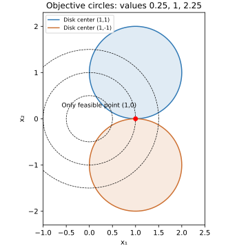

# Exercise 5.26: Tangent disks: zero gap without KKT multipliers

Source: [Boyd and Vandenberghe, Convex Optimization, exercise 5.26](https://web.stanford.edu/~boyd/cvxbook/bv_cvxbook.pdf#page=296). The source exercise and all of its subparts were checked directly.

## (a) Geometry and primal optimum

The two closed unit disks have centers $`(1,1)`$ and $`(1,-1)`$, separated by distance two. Their only common point is $`x^\star=(1,0)`$. Algebraically, adding their inequalities gives $`2(x_1-1)^2+2x_2^2\le0`$, with the same conclusion. Hence $`p^\star=1`$.



## (b) KKT conditions and failure of a finite certificate

With the two constraint functions $`f_1,f_2`$ equal to the squared distances minus one, KKT requires primal feasibility, $`\lambda_1,\lambda_2\ge0`$, $`\lambda_if_i(x)=0`$, and

```math
2x+2\lambda_1(x-(1,1))+2\lambda_2(x-(1,-1))=0.
```

At the only feasible point, the first coordinate of this equation is $`2=0`$. Thus no multipliers satisfy KKT, even though the point is globally optimal. Both constraint gradients are vertical there and cannot balance the horizontal objective gradient. Slater fails because the intersection contains no strictly feasible point.

## (c) Dual solution in value

Set $`s=\lambda_1+\lambda_2`$, $`d=\lambda_1-\lambda_2`$, so $`s\ge|d|`$. Completing squares in

```math
L=(1+s)(x_1^2+x_2^2)-2s x_1-2d x_2+s
```

gives $`x_1=s/(1+s)`$, $`x_2=d/(1+s)`$ and

```math
g(\lambda_1,\lambda_2)=s-\frac{s^2+d^2}{1+s}
=\frac{s-d^2}{1+s}.
```

The dual maximizes this concave dual function over nonnegative multipliers. It is strictly less than one at every finite pair, since $`1-g=(1+d^2)/(1+s)>0`$. Taking equal multipliers, so $`d=0`$, and letting $`s\to\infty`$ gives $`g=s/(1+s)\to1`$. Therefore $`d^\star=1=p^\star`$, and strong duality holds in value, but the dual has no optimizer. This is consistent with the absence of KKT multipliers.

## Validation

The [executed plot script](../../artifacts/exercises/5.26/plot_disks.py) draws both exact disk boundaries and several objective circles. The singleton feasible set and limiting dual value are established algebraically, not inferred from the picture.
