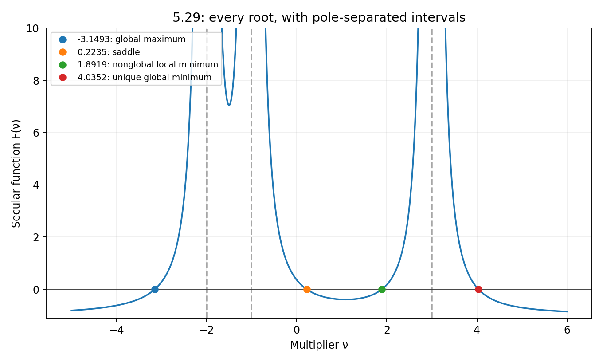

# Exercise 5.29: enumerate every stationary point

Source: Boyd and Vandenberghe, *Convex Optimization*, printed p. 282
([official PDF, p. 296](https://web.stanford.edu/~boyd/cvxbook/bv_cvxbook.pdf#page=296)).
This concrete-data proof exercise is included as an optional numerical
illustration. All stationary points are found; a local minimization run would
not answer the exercise.

## KKT reduction and completeness

Write the objective as $`x^TDx+2\mathbf1^Tx`$, where
$`D=\mathrm{diag}(-3,1,2)`$, and use the Lagrangian
$`L(x,\nu)=f(x)+\nu(x^Tx-1)`$. The KKT equations are

```math
(D+\nu I)x=-\mathbf1,\qquad x^Tx=1.
```

The multiplier cannot equal $`-2,-1,3`$: at any of those poles, one
stationarity equation would read $`0=-1`$. Otherwise,

```math
x_i=-\frac1{D_{ii}+\nu},\qquad
F(\nu)=\sum_i\frac1{(D_{ii}+\nu)^2}-1=0.
```

The implementation analyzes every pole-separated interval. On a finite
interval between consecutive poles,
$`F''(\nu)=6\sum_i(D_{ii}+\nu)^{-4}>0`$, and $`F`$ tends to positive
infinity at both ends. Thus its unique minimum determines the exact root
count. On $`(-2,-1)`$, the absolute values of the two adjacent
denominators add to one. Convexity of the reciprocal-square function gives
a sum of at least 8 for those two terms, hence $`F>7`$ and there are no
roots. On $`(-1,3)`$, the exact value $`F(1)=-7/18<0`$ proves that there
are two roots. The computed interval minima in the executed results provide
additional numerical checks of these exact sign arguments.
On each exterior interval the function is monotone from its limiting value
-1 to positive infinity (or in the opposite direction), so there is one
root on each exterior interval. This proves that the four real KKT pairs
listed in the executed results are exhaustive. Their classifications use the Lagrangian Hessian $`2(D+\nu I)`$
restricted to the tangent space $`x^Tv=0`$. Compactness of the sphere and its
nonzero constraint gradient ensure that the global extrema appear in the list.

As an independent algebraic check, clearing denominators gives

```math
\nu^6-17\nu^4-12\nu^3+49\nu^2+48\nu-13=0.
```

Its four real roots agree with the bracketed roots; its remaining two roots
are nonreal. Denominator clearing does not introduce a pole solution.

## Global minimum and dual certificate

For $`\nu>3`$, the shifted matrix is positive definite and

```math
g(\nu)=-\nu-\mathbf1^T(D+\nu I)^{-1}\mathbf1.
```

At the last root, $`g(\nu)=f(x)`$ to numerical precision, giving a global
lower bound attained by a sphere-feasible point. More directly, for any
other sphere-feasible $`y`$, stationarity gives

```math
f(y)-f(x)=(y-x)^T(D+\nu I)(y-x)>0.
```

Hence the global minimizer is unique. For the other three multipliers,
$`D+\nu I`$ is indefinite or negative definite and the Lagrangian infimum
is negative infinity. In particular, the positive tangent Hessian of the
nonglobal local minimum is not a global PSD certificate.

## Independent numerical reference and artifacts

The module separately solves the lifted semidefinite relaxation with variables
$`X,x`$, constraints $`\mathrm{tr}X=1`$ and
$`\begin{bmatrix}X&x\\x^T&1\end{bmatrix}\succeq0`$, and objective
$`\mathrm{tr}(DX)+2\mathbf1^Tx`$. It agrees with the certified
minimum, and $`X`$ is numerically $`xx^T`$. The exact secular certificate
establishes global optimality; the numerical SDP is a cross-check.

The executed results include all four pairs, interval minima/root counts,
feasibility and stationarity residuals, tangent eigenvalues, polynomial root
agreement, duality gap, and SDP feasibility/rank-one residuals. The embedded
secular plot displays every root and pole, with its vertical range truncated
for readability.

<!-- BEGIN GENERATED RESULTS -->
## Executed results

The full-size experiment was executed at **2026-10-10T03:18:57.703524Z**, with seed **0** and Python **3.12.14**. The tables below are generated directly from this run's [recorded output](../../artifacts/5.29/results.json), rather than illustrative or expected values. See the [execution record](../../coverage/results-refresh.json) for the exact command, package versions, source fingerprint, and checks.

### All stationary pairs and their classification

| Multiplier ν | Stationary point x | Objective | Classification | Tangent-Hessian eigenvalues |
| --- | --- | --- | --- | --- |
| -3.14928980662 | (0.162620405, 0.465269968, 0.870102557) | 4.64728273748 | Global maximum | (-12.048118, -3.8516345) |
| 0.223508996483 | (0.360166843, -0.81732133, -0.449739579) | -1.13040306204 | Saddle | (-4.4658803, 3.9931461) |
| 1.89189898418 | (0.9024448, -0.345793544, -0.256943976) | -1.5921917045 | Nonglobal strict local minimum | (4.5790218, 7.3717866) |
| 4.03522594618 | (-0.965972698, -0.19860082, -0.165693879) | -5.36549334295 | Unique global minimum | (9.7133167, 11.837504) |

The maximum sphere-feasibility residual is
**3.553e-15**; the maximum stationarity
residual is **2.220e-16**.

| Pole-separated interval | Computed minimum of F | Root count |
| --- | --- | --- |
| (−∞, -2) | Monotone exterior interval | 1 |
| (-2, -1) | 7.04938146169 | 0 |
| (-1, 3) | -0.392219357749 | 2 |
| (3, +∞) | Monotone exterior interval | 1 |

The independently computed polynomial roots disagree with the bracketed secular
roots by at most **4.885e-15**. At the global
minimum the shifted Lagrangian-Hessian eigenvalues are
(2.070451892, 10.07045189, 12.07045189), all positive;
the primal objective and dual value are both
**-5.36549334294838**, with recorded certified
duality gap **0**. The other three
multipliers give an unbounded-below Lagrangian.

### Independent semidefinite cross-check

| Independent lifted SDP check | Actual result |
| --- | --- |
| Solver / status | CLARABEL / optimal |
| Optimizer x | (-0.965960431079, -0.198639755249, -0.165718693285) |
| Objective | -5.3654933317351 |
| Objective error against certified minimum | 1.121e-08 |
| Euclidean point error | 4.777e-05 |
| Trace residual | 1.110e-16 |
| PSD violation | 3.770e-09 |
| Rank-one residual | 1.313e-08 |

The SDP accuracy is lower than that of the exact secular certificate, especially
in the optimizer coordinates; the objective and PSD/rank-one residuals above
make that distinction explicit. Full matrices and all KKT residuals are retained
in the JSON.


<!-- END GENERATED RESULTS -->
