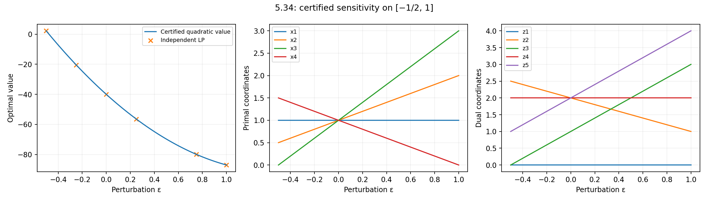

# Exercise 5.34: simultaneous cost and RHS sensitivity

Source: Boyd and Vandenberghe, *Convex Optimization*, printed p. 284
([official PDF, p. 298](https://web.stanford.edu/~boyd/cvxbook/bv_cvxbook.pdf#page=298)).
This is an optional computational illustration of a concrete-data analytic
exercise. All supplied coefficients are used. In particular, the primal
variables are free: no nonnegativity constraint on $`x`$ is present.

## Certificate and uniqueness at zero

For $`x_0=(1,1,1,1)`$, the primal slack is $`(1,0,0,0,0)`$. Take
$`z_0=(0,2,1,2,2)`$. Direct multiplication gives

```math
A^Tz_0+c=0,\qquad z_0\geq0,\qquad
c^Tx_0=-b^Tz_0=-40.
```

Primal feasibility, dual feasibility, and equal objectives prove optimality.
For primal uniqueness, every optimum must have zero slack in rows
$`I=\{2,3,4,5\}`$, because the corresponding dual multipliers are strictly
positive. The matrix $`A_I`$ is nonsingular, with determinant 8029, so those
four equations determine $`x_0`$ uniquely. Conversely, any dual optimum
must have $`z_1=0`$, since the first primal slack is strictly positive.
The remaining stationarity equations $`A_I^Tz_I=-c`$ have a unique solution.
Both optima are unique at zero.

## Continue the same basis exactly

Solving $`A_Ix=b_I+\epsilon f_I`$ and
$`A_I^Tz_I=-(c+\epsilon d)`$, with $`z_1=0`$, gives

```math
x(\epsilon)=(1,\,1+\epsilon,\,1+2\epsilon,\,1-\epsilon),
```

```math
z(\epsilon)=(0,\,2-\epsilon,\,1+2\epsilon,\,2,\,2+2\epsilon).
```

The slack vector is $`(1-\epsilon,0,0,0,0)`$. All primal and dual
inequalities reduce to

```math
\epsilon\leq1,\quad \epsilon\leq2,\quad
\epsilon\geq-1/2,\quad \epsilon\geq-1.
```

Thus the common feasibility interval is exactly $`[-1/2,1]`$. On that
closed interval, stationarity and complementarity continue to hold, so

```math
p^\star(\epsilon)=(c+\epsilon d)^Tx(\epsilon)
 =-(b+\epsilon f)^Tz(\epsilon)
 =-40-72\epsilon+25\epsilon^2.
```

The value is quadratic because both the objective coefficients and the
optimal point change. The first derivative at zero is the familiar
sensitivity expression $`d^Tx_0-f^Tz_0=-72`$; it does not imply that the
value is locally affine.

Both solutions are unique in the open interval. At the left endpoint the
third dual coordinate becomes zero and the primal solution need not be
unique; here it is not. For example, at $`\epsilon=-1/2`$, adding a small
positive multiple of $`(-2487,-5883,1223,1796)`$ to the displayed primal
point preserves the objective and feasibility. This direction annihilates
rows 2, 4, and 5, and makes row 3 slack. The dual remains unique there.

At the right endpoint the first primal slack becomes zero; the primal
remains unique, but the dual is not. A small positive multiple of
$`(8029,-2739,-61298,-15502,-8487)`$ can be added to the displayed dual
point while preserving feasibility and objective. This vector is in the
nullspace of $`A^T`$. The endpoint degeneracies do not invalidate the
displayed optimal solutions or value formula.

## Independent numerical checks

The module solves the primal and dual as separate SciPy/HiGHS LPs at zero,
several interior points, and both endpoints, reporting feasibility,
stationarity, complementarity, and objective gaps. Primal LP bounds are
explicitly `(None, None)`; relying on SciPy's default would silently add
$`x\geq0`$.

A separate free-variable regression at $`\epsilon=1.1`$, outside the
certified basis interval, finds a negative fourth coordinate, as shown in the
executed results. This is not presented as a use of the local formula. It detects the accidental nonnegativity
modeling error, which could be missed by only checking points inside the
interval, where the displayed $`x`$ happens to be nonnegative.

Endpoint point differences versus an LP solver are not errors when the
corresponding optimal set is nonunique; objective and KKT comparisons remain
appropriate there. The executed results below report those checks and embed
the sensitivity plot.

<!-- BEGIN GENERATED RESULTS -->
## Executed results

The full-size experiment was executed at **2026-10-10T03:18:58.162922Z**, with seed **0** and Python **3.12.14**. The tables below are generated directly from this run's [recorded output](../../artifacts/5.34/results.json), rather than illustrative or expected values. See the [execution record](../../coverage/results-refresh.json) for the exact command, package versions, source fingerprint, and checks.

### Primal and dual sensitivity checks

| ε | Displayed analytic optimizer x | Displayed analytic dual z | Exact value formula |
| --- | --- | --- | --- |
| -0.5 | (1, 0.5, 0, 1.5) | (0, 2.5, 0, 2, 1) | 2.25 |
| -0.25 | (1, 0.75, 0.5, 1.25) | (0, 2.25, 0.5, 2, 1.5) | -20.4375 |
| 0 | (1, 1, 1, 1) | (0, 2, 1, 2, 2) | -40 |
| 0.25 | (1, 1.25, 1.5, 0.75) | (0, 1.75, 1.5, 2, 2.5) | -56.4375 |
| 0.75 | (1, 1.75, 2.5, 0.25) | (0, 1.25, 2.5, 2, 3.5) | -79.9375 |
| 1 | (1, 2, 3, 0) | (0, 1, 3, 2, 4) | -87 |

| ε | Primal LP value | Dual LP value | Primal–dual gap | Stationarity residual |
| --- | --- | --- | --- | --- |
| -0.5 | 2.25 | 2.25 | 2.309e-14 | 1.005e-14 |
| -0.25 | -20.4375 | -20.4375 | 7.105e-15 | 7.944e-15 |
| 0 | -40 | -40 | 7.105e-15 | 7.944e-15 |
| 0.25 | -56.4375 | -56.4375 | 7.105e-15 | 0 |
| 0.75 | -79.9375 | -79.9375 | 1.421e-14 | 1.005e-14 |
| 1 | -87 | -87 | 1.421e-14 | 7.944e-15 |

Every listed primal and dual SciPy/HiGHS run returned:
**Optimization terminated successfully. (HiGHS Status 7: Optimal)**. Across those runs, maximum primal violation is
**7.105e-15**,
maximum dual nonnegativity violation is
**0**, and maximum
complementarity residual is
**9.566e-15**.
The maximum error against the quadratic value formula is
**1.421e-14**.

At ε = −0.5 the primal is nonunique; at ε = 1 the dual is nonunique.
At the latter endpoint HiGHS actually returned
$`z=(0.392949199, 0.8659499494, 0, 1.24131293, 3.584635714)`$, a distance
**3.14968443639** from the displayed analytic dual,
while attaining the same optimal value. This coordinate difference is expected
from nonuniqueness, not a failed optimality check.

### Free-variable regression outside the basis interval

At ε = **1.1**, the independent LP returned
$`x=(0.995942771379, 2.09040262325, 3.20199517113, -0.0970700512252)`$ and objective
**-88.9080854187739**. The fourth coordinate is negative, as allowed
by the original problem. Both LP statuses are optimal; the measured primal–dual
gap is **2.842e-14**, primal violation
**3.553e-15**, and stationarity residual
**3.553e-15**. This point is outside the proven
sensitivity interval and is not evaluated using its local formula.


<!-- END GENERATED RESULTS -->
