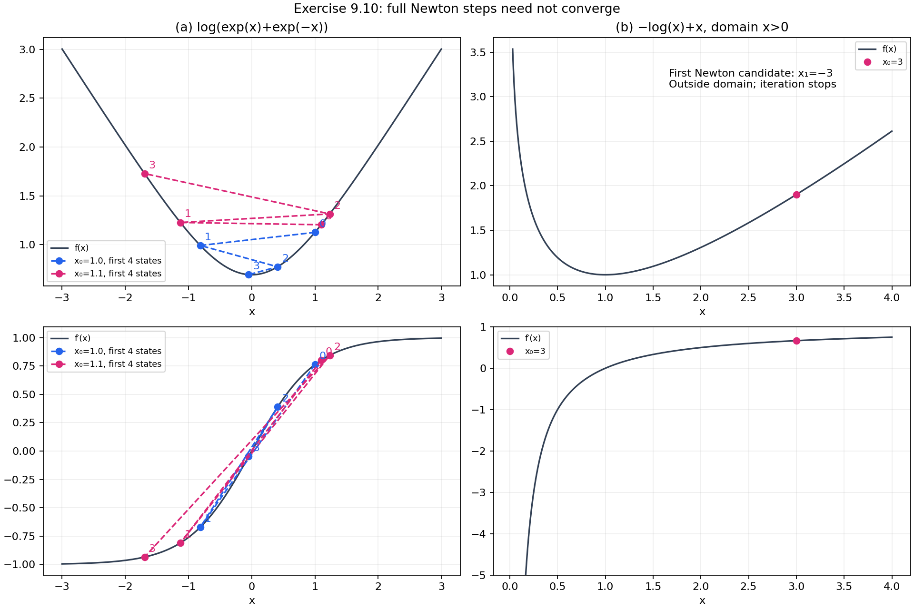

# Exercise 9.10 — Why full Newton steps can fail

**Source:** Boyd and Vandenberghe, *Convex Optimization*, Exercise 9.10, printed p. 515 ([official book](https://web.stanford.edu/~boyd/cvxbook/bv_cvxbook.pdf#page=529)). This is an original derivation and implementation. The exercise has no external data and no random parameters.

## (a) The log-sum-exp example

For the scalar function under consideration,

\[
f(x)=\log(e^x+e^{-x}),\quad f'(x)=\tanh x,\quad
f''(x)=\operatorname{sech}^2x>0.
\]

The sole stationary point, and hence the unique minimizer, is zero. The full-step Newton map is

\[
T(x)=x-\frac{\tanh x}{\operatorname{sech}^2x}
=x-\tfrac12\sinh(2x).
\]

This formula avoids dividing by a Hessian that numerically approaches zero. Function values use `logaddexp(x, -x)` to avoid exponentiating large positive numbers.

| k | Starting at 1 | Starting at 1.1 |
|---:|---:|---:|
| 0 | 1 | 1.1 |
| 1 | −0.8134302039 | −1.1285525853 |
| 2 | 0.4094023166 | 1.2341311330 |
| 3 | −0.04730491646 | −1.6951659799 |
| 4 | 0.00007060280364 | 5.7153601004 |
| 5 | −2.3463 × 10⁻¹³ | −23021.3564857 |

The first sequence reaches the minimizer. The second alternates sign while its magnitude increases dramatically. The implementation stops *before* evaluating the next overflowing hyperbolic sine and reports a divergence guard; it does not replace overflow with a spurious solution.

There is also an exact explanation for the split. Let \(a>0\) be the nonzero root of \(\sinh(2a)=4a\), numerically \(a=1.08865949248\). Since \(\sinh(2x)>2x\) for positive \(x\), the map reverses sign. For \(0<x<a\), \(|T(x)|<x\), so the magnitudes decrease to zero. For \(x>a\), \(|T(x)|>x\). An increasing, bounded magnitude sequence would have to approach a positive fixed magnitude satisfying the same equation, which is impossible above \(a\); thus it is unbounded. At \(a\), the method has a two-cycle \(a,-a\). Near zero, \(T(x)=-(2/3)x^3+O(x^5)\), so this particular symmetric example is locally cubic, stronger than generic quadratic Newton convergence.

## (b) The logarithmic barrier example

For \(f(x)=-\log x+x\), defined for \(x>0\),

\[
f'(x)=1-1/x,\qquad f''(x)=1/x^2,\qquad T(x)=2x-x^2.
\]

The minimizer is \(x=1\), but starting at \(x=3\) produces the first candidate \(T(3)=-3\), outside the domain. There is no valid second objective value. The result records `invalid_candidate = -3` and `status = left_domain`; it does not continue the polynomial recurrence as if it were Newton's method on the original function.

## Reproduce and inspect

```python
from pathlib import Path
from convex_solutions.chapters.ch09.ex_9_10 import solve
result = solve(Path("artifacts/9.10"))
```

`results.json` stores both sequences and their termination reasons. `pure_newton_examples.png` plots both functions and derivatives, labels the first four states of each log-sum-exp sequence, and marks the invalid barrier update.



Tests verify the specified starts, convergence/divergence, the exact invalid first step, and stable evaluation at large arguments. The practical conclusion is that strict convexity alone does not make undamped Newton globally convergent; a feasibility-preserving line search resolves both issues in the subsequent experiments.
