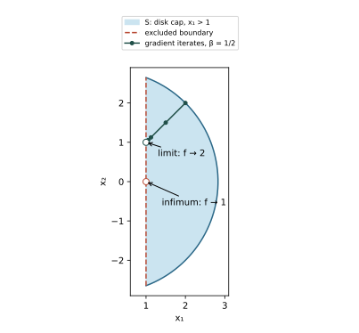

# Exercise 9.3: A nonclosed sublevel set breaks gradient convergence

Source: Boyd and Vandenberghe, *Convex Optimization*, exercise 9.3, printed page 514. [Official book](https://web.stanford.edu/~boyd/cvxbook/bv_cvxbook.pdf#page=528).

## (a) Infimum
The domain is $`x_1>1`$, so $`f=x_1^2+x_2^2>1`$. Points $`(1+\epsilon,0)`$ approach value one, giving $`p^\star=1`$, which is not attained.

## (b) Sublevel geometry and strong convexity
At $`x^{(0)}=(2,2)`$ the value is eight, so
```math
S=\{(x_1,x_2):x_1>1,\ x_1^2+x_2^2\le8\}.
```
It is the part of the closed radius-$`\sqrt8`$ disk strictly to the right of the line $`x_1=1`$. It is not closed: $`(1+1/j,0)\to(1,0)\notin S`$. Nevertheless its Hessian is $`2I`$, so the function is strongly convex on $`S`$ with constant two.



## (c) Backtracking iterates
The negative gradient is $`-2x`$, so every iterate remains on the ray $`x_1=x_2=s`$, starting with $`s_0=2`$. With standard parameters $`0<\alpha<1/2`$, $`0<\beta<1`$, feasibility of a step requires
```math
s(1-2t)>1\quad\Longleftrightarrow\quad
0<t<\frac{s-1}{2s}<\frac12.
```
The Armijo condition for this quadratic is $`t\le1-\alpha`$, and is automatically satisfied by every feasible step. Therefore backtracking selects the first power of $`\beta`$ strictly below $`T=(s-1)/(2s)`$. The previous power is at least $`T`$, giving $`t\ge\beta T`$. Hence
```math
0<s_{k+1}-1=s_k-1-2t_ks_k\le(1-\beta)(s_k-1).
```
Thus $`s_k\downarrow1`$, the iterates converge to the excluded point $`(1,1)`$, and $`f(x^{(k)})\to2>p^\star`$. Strong convexity alone does not rescue the convergence theorem when the required sublevel-set closedness fails.
