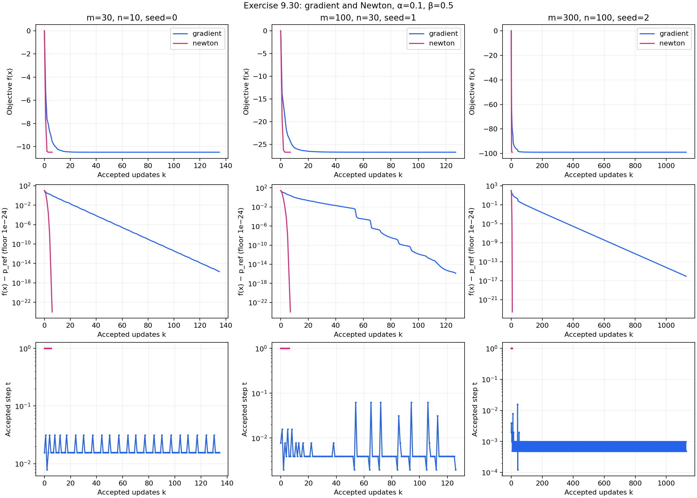
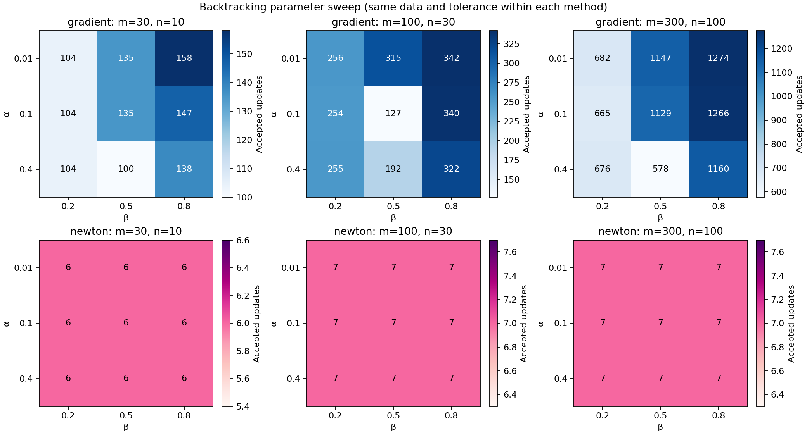
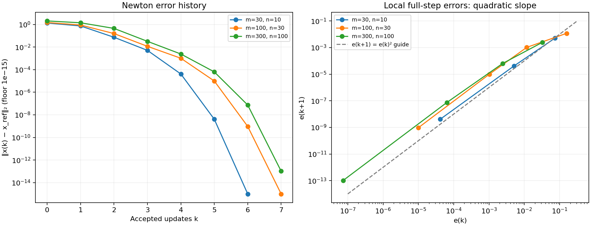
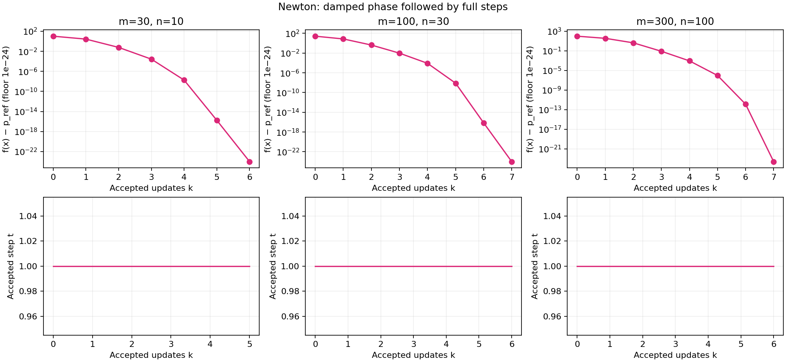

# Exercise 9.30 — Gradient descent and Newton analytic centering

**Source:** Boyd and Vandenberghe, *Convex Optimization*, Exercise 9.30, printed p. 519 ([official book](https://web.stanford.edu/~boyd/cvxbook/bv_cvxbook.pdf#page=533)). This is an original solution, with no solution-manual dependency. Both requested methods, all plots, several sizes, and backtracking-parameter experiments are included.

## Derivatives and well-posedness

Place $`a_i^T`$ in row $`i`$ of $`A`$, and write $`s=\mathbf1-Ax`$. For the analytic-center objective,

```math
f(x)=-\sum_i\log s_i-\sum_j\log(1-x_j^2),
```

all evaluations take place in $`s\succ0`$, $`|x_j|<1`$. Applying the chain rule gives

```math
\nabla f(x)=A^T s^{-1}+\frac{2x}{1-x^2},
```

```math
\nabla^2f(x)=A^T\mathrm{diag}(s^{-2})A
+\mathrm{diag}\!\left(\frac{2(1+x^2)}{(1-x^2)^2}\right).
```

Powers, divisions, and reciprocals in these expressions are entrywise. The Hessian is positive definite, even when $`A`$ is rank deficient, because its diagonal contribution is at least $`2I`$. The domain is nonempty (it contains zero), convex, and bounded; the barrier tends to positive infinity on its boundary. Therefore a unique minimizer exists in the interior.

The global strong-convexity bound provides a useful independent certificate:

```math
0\le f(x)-p^\star\le\|\nabla f(x)\|_2^2/4.
```

This follows by minimizing the quadratic lower bound with curvature $`2I`$. It also bounds the accuracy of the numerical reference value without treating a solver termination flag as a proof of accuracy. Reported bounds are floating-point diagnostics, not interval-arithmetic certificates.

## (a) Gradient method

The search direction is $`d=-\nabla f(x)`$. Starting from $`t=1`$, reject infeasible candidates, then shrink $`t\leftarrow\beta t`$ until

```math
f(x+td)-f(x)\le\alpha t\nabla f(x)^Td.
```

Each run starts at zero and stops when $`\|\nabla f(x)\|_2\le10^{-7}`$. No matrix inverse is formed. The stopping criterion certifies objective error at most $`2.5\times10^{-15}`$ in exact arithmetic.

The experiment uses independent standard normal matrix entries. The three $`(m,n,\text{seed})`$ choices are $`(30,10,0)`$, $`(100,30,1)`$, and $`(300,100,2)`$. For every instance, all nine pairs from $`\alpha\in\{0.01,0.1,0.4\}`$ and $`\beta\in\{0.2,0.5,0.8\}`$ are run. These are nine independent runs from zero, not a warm-start sequence.

## (b) Newton method

Compute a Cholesky factorization of the symmetric positive-definite Hessian, solve

```math
\nabla^2 f(x)d=-\nabla f(x),\qquad \lambda^2=-\nabla f(x)^Td,
```

and apply the same feasible Armijo search. Stop when $`\lambda^2/2\le10^{-20}`$. The tighter tolerance intentionally exposes the local convergence phase. A separate reference solve uses $`\lambda^2/2\le10^{-25}`$, and its gradient certificate is reported. There is no claim that equal numerical values of gradient and decrement tolerances are equivalent.

## Interpretation of the full-size experiment

The executed results below include the full reference solutions' diagnostics,
baseline method outputs, and all nine line-search choices for every size.
The complete pairwise counts, final residuals, feasibility margins, and total
backtracks are also linked as CSV; the heatmap displays every count.

A larger $`\beta`$ tests step sizes more finely but can require more backtracking evaluations. A smaller $`\beta`$ can jump past a good step length. A larger $`\alpha`$ requires more decrease and can force shorter steps, although the resulting sequence can sometimes converge in fewer accepted updates. The measured counts are not monotone in either parameter, so there is no universally best pair in this experiment. Iteration count alone also omits the much higher cost of a Newton update.

### Quadratic convergence

Let $`e_k=\|x_k-x_{\rm ref}\|_2`$. The diagnostic reports $`e_{k+1}/e_k^2`$ only for full steps with $`10^{-8}<e_k<0.2`$ and $`e_{k+1}>10^{-13}`$, avoiding the floating-point floor. It also reports the observed order

```math
q_k=\frac{\log(e_{k+1}/e_k)}{\log(e_k/e_{k-1})}
```

when two successive steps are full and errors decrease. These are empirical local-rate diagnostics, not a guarantee that every pre-asymptotic iteration already has order two.

The executed results report the final measurable quadratic ratios and observed
orders for each instance. The smaller instance has fewer iterations before
roundoff, so its measured local order is less settled.

## Numerical safeguards and reproduction

Near the solution, subtracting two objective values loses all meaningful digits. Line-search comparisons and plotted gaps instead sum logarithms of *relative slack changes*, using `log1p` and extended-precision accumulation where NumPy supports it. The feasibility test uses the actual candidate. Plot floors are explicitly labeled; raw gaps are retained in JSON rather than silently forcing them nonnegative.

```python
from pathlib import Path
from convex_solutions.chapters.ch09.ex_9_30 import solve, run_experiment
result = solve(Path("artifacts/9.30"), seed=0)
# Same coverage with smaller dimensions, useful as a smoke experiment:
small = run_experiment(None, seed=0, quick=True)
```

The repository entry point and the generated results below use seed zero, with each successive instance incrementing that seed. Passing `output_dir=None` runs the calculations without writing files or creating plots. `make_instance` and the two solver functions allow arbitrary dimensions, starts, tolerances, and valid backtracking parameters.

Outputs include four PNGs, `results.json`, `parameter_sweep.csv`, scalar traces for all runs plus full baseline iterates in `histories.json`, and compressed generated matrices/reference points. No input data download is needed at runtime. Tests check finite-difference derivatives, global curvature, strict feasibility, monotonic descent, both stopping criteria, line-search geometry, local convergence order, error bounds, and agreement with an independently modeled CVXPY/CLARABEL log-barrier problem.

<!-- BEGIN GENERATED RESULTS -->
## Executed results

The full-size experiment was executed at **2026-10-10T03:19:23.000173Z**, with seed **0** and Python **3.12.14**. The tables below are generated directly from this run's [recorded output](../../artifacts/9.30/results.json), rather than illustrative or expected values. See the [execution record](../../coverage/results-refresh.json) for the exact command, package versions, source fingerprint, and checks.

### Reference solutions and baseline methods

| (m,n); instance seed | Reference objective | Reference gradient norm | Objective-error bound | Hessian condition |
| --- | --- | --- | --- | --- |
| (30,10); 0 | -10.4753893841365 | 6.534e-15 | 1.067e-29 | 15.395666 |
| (100,30); 1 | -26.7379911416259 | 4.024e-14 | 4.048e-28 | 35.827431 |
| (300,100); 2 | -98.908513942472 | 2.867e-13 | 2.055e-26 | 130.51561 |

The following baseline uses α = 0.1 and β = 0.5. A domain margin is the minimum
of all linear and box slacks over the recorded trajectory, so a positive value
also checks feasibility of the intermediate iterates.

| (m,n) | Method | Updates | Final objective | Final gradient norm | Final λ²/2 | Minimum domain margin | Status / stopping test |
| --- | --- | --- | --- | --- | --- | --- | --- |
| (30,10) | gradient | 135 | -10.4753893841365 | 8.666e-08 | — | 0.1342405 | converged / gradient_norm |
| (30,10) | newton | 6 | -10.4753893841365 | 6.534e-15 | 8.103e-31 | 0.1751946 | converged / newton_decrement |
| (100,30) | gradient | 127 | -26.7379911416259 | 7.312e-08 | — | 0.05518598 | converged / gradient_norm |
| (100,30) | newton | 7 | -26.7379911416259 | 4.024e-14 | 5.142e-30 | 0.2062202 | converged / newton_decrement |
| (300,100) | gradient | 1129 | -98.908513942472 | 9.909e-08 | — | 0.04772408 | converged / gradient_norm |
| (300,100) | newton | 7 | -98.908513942472 | 8.262e-11 | 2.626e-24 | 0.1545425 | converged / newton_decrement |

### Full backtracking-parameter sweep

Every cell is **gradient updates / Newton updates**, from a separate start at zero.

| α | β | (30,10) gradient / Newton | (100,30) gradient / Newton | (300,100) gradient / Newton |
| --- | --- | --- | --- | --- |
| 0.01 | 0.2 | 104 / 6 | 256 / 7 | 682 / 7 |
| 0.01 | 0.5 | 135 / 6 | 315 / 7 | 1147 / 7 |
| 0.01 | 0.8 | 158 / 6 | 342 / 7 | 1274 / 7 |
| 0.1 | 0.2 | 104 / 6 | 254 / 7 | 665 / 7 |
| 0.1 | 0.5 | 135 / 6 | 127 / 7 | 1129 / 7 |
| 0.1 | 0.8 | 147 / 6 | 340 / 7 | 1266 / 7 |
| 0.4 | 0.2 | 104 / 6 | 255 / 7 | 676 / 7 |
| 0.4 | 0.5 | 100 / 6 | 192 / 7 | 578 / 7 |
| 0.4 | 0.8 | 138 / 6 | 322 / 7 | 1160 / 7 |

**54/54 runs converged**.
The largest final gradient norm across gradient runs is
**9.975e-08**; the largest
final half-decrement across Newton runs is
**2.626e-24**.
The smallest domain margin over the complete sweep is
**0.0231498655**, strictly positive.

### Local Newton convergence

| (m,n) | Last two measurable quadratic ratios | Last two measured orders |
| --- | --- | --- |
| (30,10) | 1.582226, 2.381537 | 1.800496, 1.915078 |
| (100,30) | 9.431692, 9.485163 | 1.90549, 1.99878 |
| (300,100) | 18.18544, 18.85563 | 1.85494, 1.994645 |

These full-step measurements use the roundoff exclusions described above.
The larger two instances show successive observed orders approaching two.









Full scalar traces and baseline optimizer coordinates are in
[histories.json](../../artifacts/9.30/histories.json); all parameter counts and
residuals are also in [parameter_sweep.csv](../../artifacts/9.30/parameter_sweep.csv).
Generated matrices and reference optimizers: [(30,10) arrays](../../artifacts/9.30/instance_m30_n10.npz), [(100,30) arrays](../../artifacts/9.30/instance_m100_n30.npz), [(300,100) arrays](../../artifacts/9.30/instance_m300_n100.npz).
<!-- END GENERATED RESULTS -->
