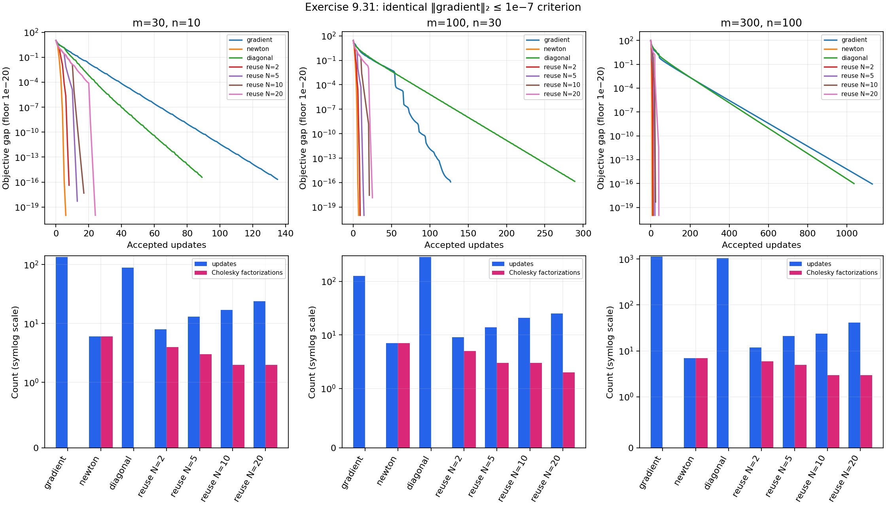

# Exercise 9.31 — Approximate Newton directions

**Source:** Boyd and Vandenberghe, *Convex Optimization*, Exercise 9.31, printed pp. 519–520 ([official book](https://web.stanford.edu/~boyd/cvxbook/bv_cvxbook.pdf#page=533)). This original solution implements both approximations and compares them with gradient descent and exact Newton on the analytic-centering instances from [9.30](9.30.md).

## Common setup

All methods begin at zero. Every accepted step is strictly feasible and satisfies Armijo backtracking with $`\alpha=0.1,\beta=0.5`$. For a fair comparison, **all methods use the identical stopping criterion** $`\|\nabla f(x)\|_2\le10^{-7}`$. This differs intentionally from the method-specific stopping criteria in Exercise 9.30, so its Newton iteration counts need not be identical.

The three matrix sizes are $`(m,n)=(30,10),(100,30),(300,100)`$, with independent standard normal entries and seeds 0, 1, and 2. A high-accuracy Newton solution supplies reference values, while $`\|\nabla f\|^2/4`$ bounds suboptimality independently of the approximation used.

## (a) Reuse a Hessian and its factorization

For each $`N\in\{2,5,10,20\}`$, refresh $`H=\nabla^2 f(x_k)`$ and its Cholesky factors whenever $`k`$ is a multiple of $`N`$, including $`k=0`$. On intervening iterations use the stored factors to solve $`Hd=-\nabla f(x_k)`$. The matrix is stale, but remains positive definite, so

```math
\nabla f(x_k)^Td=-\nabla f(x_k)^TH^{-1}\nabla f(x_k)<0
```

away from stationarity. Consequently feasible backtracking can still find a decreasing step. The code counts actual Hessian evaluations and factorizations; it does not secretly recompute the current Hessian during reuse steps.

For dense $`A`$, a refresh costs roughly $`O(mn^2+n^3)`$. Other iterations require gradient computation, line search, and an $`O(n^2)`$ triangular solve. Increasing $`N`$ therefore trades fewer factorizations for less accurate search directions and potentially more iterations.

## (b) Use only the Hessian diagonal

With $`s=1-Ax`$, the required entries are

```math
D_{jj}=\sum_i A_{ij}^2/s_i^2+\frac{2(1+x_j^2)}{(1-x_j^2)^2}.
```

Compute this vector directly in $`O(mn)`$, without constructing the dense Hessian, and take $`d_j=-g_j/D_{jj}`$. Each diagonal entry is positive, so the direction is again a strict descent direction away from the optimum. This is a coordinate-scaled gradient method; it corrects unequal coordinate scales but ignores cross-coordinate curvature.

## Interpreting work counts

The executed comparison below reports accepted updates and actual Cholesky
factorizations for all methods, along with the final gradient residuals and
feasibility diagnostics. Diagonal and gradient methods use no Cholesky
factorization. Reusing a Hessian saves factorizations, at the price of more
updates. The diagonal method's relative performance depends on the instance.
This is an instance-dependent observation; the experiment does not claim a universal wall-clock speed ordering. Factorization counts omit gradients, line searches, and solves, and therefore are a structural cost measure rather than a timing benchmark.

## Reproduce and validate

```python
from pathlib import Path
from convex_solutions.chapters.ch09.ex_9_31 import run_experiment
result = run_experiment(Path("artifacts/9.31"), seed=0)
# periods and dimensions are configurable.
```

`solve(output_dir=None, seed=0)` is the repository entry point. `results.json` stores objective/gap/gradient/step histories, margins, and work counts for every run. Tests compare the direct diagonal formula to the full Hessian, verify convergence and feasibility of both approximations, check the exact refresh count, and show that reuse with period one reproduces exact Newton step for step.

<!-- BEGIN GENERATED RESULTS -->
## Executed results

The full-size experiment was executed at **2026-10-10T03:19:26.090310Z**, with seed **0** and Python **3.12.14**. The tables below are generated directly from this run's [recorded output](../../artifacts/9.31/results.json), rather than illustrative or expected values. See the [execution record](../../coverage/results-refresh.json) for the exact command, package versions, source fingerprint, and checks.

### (a) Hessian reuse and (b) diagonal approximation

| Method | (30,10) updates / factorizations | (100,30) updates / factorizations | (300,100) updates / factorizations |
| --- | --- | --- | --- |
| gradient | 135 / 0 | 127 / 0 | 1129 / 0 |
| newton | 6 / 6 | 7 / 7 | 7 / 7 |
| diagonal | 89 / 0 | 289 / 0 | 1036 / 0 |
| reuse N=2 | 8 / 4 | 9 / 5 | 12 / 6 |
| reuse N=5 | 13 / 3 | 14 / 3 | 21 / 5 |
| reuse N=10 | 17 / 2 | 21 / 3 | 24 / 3 |
| reuse N=20 | 24 / 2 | 25 / 2 | 41 / 3 |

All **21** recorded statuses are
**converged**. The shared stopping tolerance is checked by the
actual final norms below, rather than inferred from update counts.

| Method | (30,10) final gradient norm | (100,30) final gradient norm | (300,100) final gradient norm |
| --- | --- | --- | --- |
| gradient | 8.666e-08 | 7.312e-08 | 9.909e-08 |
| newton | 6.534e-15 | 4.024e-14 | 8.262e-11 |
| diagonal | 8.645e-08 | 8.836e-08 | 9.441e-08 |
| reuse N=2 | 9.063e-08 | 3.521e-12 | 7.073e-09 |
| reuse N=5 | 9.866e-09 | 1.329e-09 | 2.815e-13 |
| reuse N=10 | 2.757e-08 | 4.676e-08 | 5.471e-08 |
| reuse N=20 | 1.410e-09 | 2.256e-08 | 3.972e-10 |

| (m,n); instance seed | Reference objective | Largest final absolute gap | Largest gradient-based error bound | Smallest trajectory margin |
| --- | --- | --- | --- | --- |
| (30,10); 0 | -10.4753893841365 | 3.795e-16 | 2.054e-15 | 0.11549125 |
| (100,30); 1 | -26.7379911416259 | 1.459e-16 | 1.952e-15 | 0.0551859822 |
| (300,100); 2 | -98.908513942472 | 9.957e-17 | 2.455e-15 | 0.0345815021 |

The gradient-based bound is computed from each recorded final norm as
$`\|\nabla f\|_2^2/4`$. Positive trajectory margins confirm strict feasibility.
Full final optimizers (including all 100 coordinates of the largest instance),
objective histories, step lengths, backtracks, and actual Hessian/diagonal
work counts are preserved in the JSON.

Hessian reuse reduces factorization counts while increasing accepted updates.
The diagonal approximation is faster in update count than gradient descent
on the smallest and largest instances, but slower on the middle one; no
universal wall-clock speed ranking follows from these counts.


<!-- END GENERATED RESULTS -->
