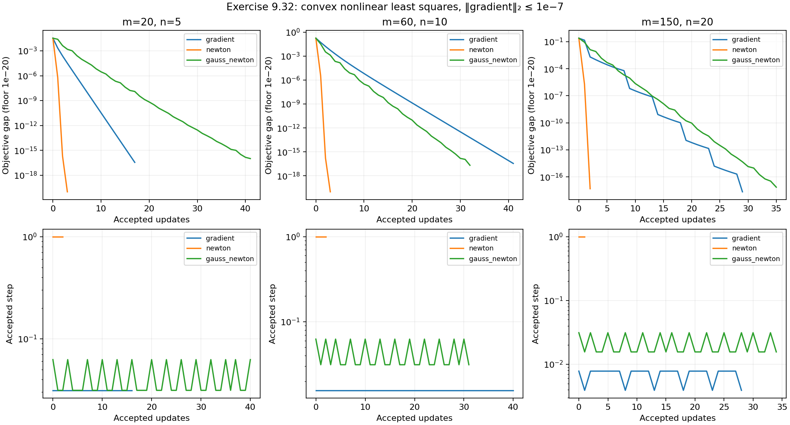

# Exercise 9.32 — Gauss–Newton for convex nonlinear least squares

**Source:** Boyd and Vandenberghe, *Convex Optimization*, Exercise 9.32, printed p. 520 ([official book](https://web.stanford.edu/~boyd/cvxbook/bv_cvxbook.pdf#page=534)). This is an original implementation and analysis of the requested quadratic-residual experiments.

## Convexity and derivatives

Use residuals $`r_i(x)=\tfrac12x^TA_ix+b_i^Tx+1`$, with $`A_i\succ0`$, and objective $`F(x)=\tfrac12\sum_i r_i(x)^2`$. Completing the square gives

```math
r_i(x)=\tfrac12(x+A_i^{-1}b_i)^TA_i(x+A_i^{-1}b_i)
+1-\tfrac12b_i^TA_i^{-1}b_i.
```

The stated bound $`b_i^TA_i^{-1}b_i\le2`$ makes every residual nonnegative and convex. Squaring is convex and increasing on the nonnegative half-line, so each squared residual is convex.

Let row $`i`$ of $`J`$ be $`(A_ix+b_i)^T`$. Then

```math
\nabla F=J^Tr,\qquad
\nabla^2F=J^TJ+\sum_i r_iA_i.
```

The second term is positive semidefinite. Exact Newton retains it; Gauss–Newton discards it. At each iteration Gauss–Newton solves

```math
\min_d\|Jd+r\|_2^2,
```

whose normal equations are $`J^TJd=-J^Tr`$. The implementation uses NumPy's SVD-based least-squares solver, avoiding an explicit inverse and the condition-number squaring from explicitly forming and solving the normal equations. It checks full column rank and reports a clear status if this assumption fails; it does not silently substitute an unrequested regularization.

With full column rank, $`g^Td=-g^T(J^TJ)^{-1}g<0`$, so the direction is suitable for Armijo backtracking. There are no domain restrictions in this exercise. All methods start at zero and use $`\alpha=0.1,\beta=0.5`$, stopping at $`\|\nabla F\|_2\le10^{-7}`$.

## Generated instances and certificates

The three $`(m,n,\text{seed})`$ triples are $`(20,5,0)`$, $`(60,10,1)`$, and $`(150,20,2)`$. Generate an independent Gaussian matrix $`R_i`$ for each residual and set

```math
A_i=R_i^TR_i/n+0.5I.
```

Start with independent Gaussian $`b_i`$, then rescale each to satisfy $`b_i^TA_i^{-1}b_i=\rho_i`$, where $`\rho_i`$ is sampled uniformly in $`[0.1,1.5]`$. This enforces the exercise's assumptions rather than hoping a random draw meets them. In particular, the residual lower bounds $`c_i=1-\rho_i/2`$ are at least 0.25.

Thus $`\nabla^2F(x)\succeq\sum_i c_iA_i\succ0`$. If $`\mu=\lambda_{\min}(\sum_i c_iA_i)`$, the computable global bound

```math
F(x)-F^\star\le\|\nabla F(x)\|_2^2/(2\mu)
```

certifies each result's accuracy up to floating-point evaluation error. Reference solutions use exact Newton with gradient tolerance $`10^{-12}`$. These are numerical certificates, not rigorously rounded interval bounds.

## Results and interpretation

The executed results below report every method's status, final objective,
update count, gradient norm, and objective-error bound, together with the
Jacobian rank and line-search diagnostics.

Gauss–Newton works on all three instances, but it does not inherit Newton's fast local rate automatically. Here the residuals remain positive at the solution, so the omitted curvature $`\sum_i r_iA_i`$ does not vanish. Full Gauss–Newton steps can overshoot, and backtracking selects short steps. Its observed convergence is broadly linear; on the smallest and largest instances it takes more updates than ordinary gradient descent. Exact Newton uses the missing curvature and converges in far fewer updates for these starts.

This comparison concerns accepted updates, not wall-clock speed. It illustrates that Gauss–Newton is most attractive when the residual term discarded from the Hessian is small or cheap least-squares structure outweighs the extra iterations.

## Reproduction and checks

```python
from pathlib import Path
from convex_solutions.chapters.ch09.ex_9_32 import run_experiment
result = run_experiment(Path("artifacts/9.32"), seed=0)
```

The standard repository entry point is `solve(output_dir=None, seed=0)`. Dimensions, starts, tolerances, and line-search parameters can also be changed through the exposed functions. Generated arrays and reference solutions are saved as compressed NPZ files when an output directory is supplied. `results.json` records all scalar traces, Jacobian extreme singular values, convexity bounds, and suboptimality estimates.

For accurate near-optimal line-search decisions, the implementation uses the algebraic residual change
$`\Delta r_i=tJ_id+\tfrac12t^2d^TA_id`$, and sums $`r_i\Delta r_i+\tfrac12(\Delta r_i)^2`$, instead of subtracting nearly equal objective values. Tests verify finite-difference derivatives, the enforced residual and strong-convexity bounds, normal-equation residuals, full rank, descent, all three methods' agreement, and an independent CVXPY/CLARABEL formulation written in completed-square form. The independent conic comparison uses tolerances of `1e-8` that attain the solver's accurate `optimal` status; no inaccurate status is silently treated as a pass. Its independent gradient-based objective-error bound must also be below `1e-8`.

<!-- BEGIN GENERATED RESULTS -->
## Executed results

The full-size experiment was executed at **2026-10-10T03:19:26.859466Z**, with seed **0** and Python **3.12.14**. The tables below are generated directly from this run's [recorded output](../../artifacts/9.32/results.json), rather than illustrative or expected values. See the [execution record](../../coverage/results-refresh.json) for the exact command, package versions, source fingerprint, and checks.

### Generated-instance checks and numerical references

| (m,n); instance seed | Reference objective | Reference gradient norm | Strong-convexity lower bound μ | Minimum residual lower bound |
| --- | --- | --- | --- | --- |
| (20,5); 0 | 9.96631856393891 | 4.596e-16 | 15.45716149 | 0.2933815763 |
| (60,10); 1 | 29.8248998804975 | 1.400e-15 | 46.39889187 | 0.2514492885 |
| (150,20); 2 | 74.7520449264047 | 2.955e-15 | 120.9276658 | 0.2557688689 |

All minimum residual bounds and strong-convexity bounds are positive, verifying
the generated instances' required convexity assumptions numerically.

### Gradient, exact Newton, and Gauss–Newton

| (m,n) | Method | Status | Updates | Final objective | Final gradient norm | Objective-error bound |
| --- | --- | --- | --- | --- | --- | --- |
| (20,5) | gradient | converged | 17 | 9.96631856393891 | 5.573e-08 | 1.005e-16 |
| (20,5) | newton | converged | 3 | 9.96631856393891 | 4.596e-16 | 6.832e-33 |
| (20,5) | gauss-newton | converged | 41 | 9.96631856393891 | 8.287e-08 | 2.221e-16 |
| (60,10) | gradient | converged | 41 | 29.8248998804975 | 8.703e-08 | 8.161e-17 |
| (60,10) | newton | converged | 3 | 29.8248998804975 | 1.400e-15 | 2.114e-32 |
| (60,10) | gauss-newton | converged | 32 | 29.8248998804975 | 6.233e-08 | 4.186e-17 |
| (150,20) | gradient | converged | 29 | 74.7520449264047 | 3.176e-08 | 4.170e-18 |
| (150,20) | newton | converged | 2 | 74.7520449264047 | 4.756e-08 | 9.353e-18 |
| (150,20) | gauss-newton | converged | 35 | 74.7520449264047 | 5.872e-08 | 1.426e-17 |

The objective-error bounds use the recorded gradient norms and μ, so they do
not depend on subtracting nearly equal objective values. Every recorded method
meets its gradient tolerance.

| (m,n) | Smallest recorded singular value of J | Accepted Gauss–Newton step range | Total backtracks |
| --- | --- | --- | --- |
| (20,5) | 0.790351592 | 0.03125–0.0625 | 191 |
| (60,10) | 1.38544812 | 0.03125–0.0625 | 148 |
| (150,20) | 1.62175757 | 0.015625–0.03125 | 197 |

The positive minimum singular values verify full column rank throughout the
Gauss–Newton trajectories. Short accepted steps and repeated backtracking show
why these runs need more updates than exact Newton despite converging.
Full optimizers, singular-value traces, and step histories are in the JSON;
generated arrays and reference points are available as [(20,5) arrays](../../artifacts/9.32/instance_m20_n5.npz), [(60,10) arrays](../../artifacts/9.32/instance_m60_n10.npz), [(150,20) arrays](../../artifacts/9.32/instance_m150_n20.npz).


<!-- END GENERATED RESULTS -->
